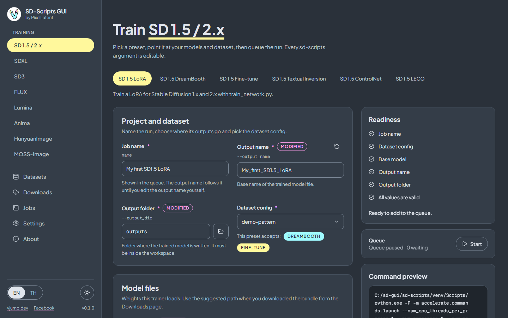

<p align="center">
  
</p>

<h1 align="center">SD-Scripts GUI</h1>

<p align="center">by PixelLatent</p>

<p align="center"><a href="README.md">English</a> | <a href="README.th.md">ภาษาไทย</a></p>

A web and desktop GUI for [kohya-ss sd-scripts](https://github.com/kohya-ss/sd-scripts): configure a LoRA, fine-tune or other training run with forms, queue it, and watch it train.



## Features

- **Every argument of every training script.** The forms are generated from the argument schema of the sd-scripts scripts (24 scripts), so all models and all parameters are supported. Curated presets give you a good starting point, and **All parameters** gives you the rest, with search and a modified-only filter.
- **8 model families, 25 presets.** LoRA, fine-tune, DreamBooth, Textual Inversion, ControlNet, ControlNet-LLLite and LECO, see the table below.
- **Command preview.** See the exact command before you run it. Export and import the form as a JSON config.
- **Job queue.** Jobs run one at a time, and each **Start** runs exactly one job. Live log, progress by step and epoch, per-file and zip download of the results, cancel that kills the whole process tree, retry, reorder.
- **Dataset tools.** Upload images with `.txt` captions in the browser, edit captions, build dataset configs (TOML) in a form, import, export and validate them.
- **Model downloads.** One-click, verified Hugging Face bundles into the workspace. Files already there are skipped.
- **System monitor.** CPU, RAM, GPU utilization, VRAM and temperature while a job runs.
- **Runs where you train.** A Windows desktop app (`install.bat` and `run.bat`, no `.exe`) or a Docker image for Runpod and Vast.ai with JupyterLab included.
- **English and Thai** interface, light and dark theme.
- **Safe defaults.** Writes are confined to one workspace folder, commands run without a shell, secrets stay in memory, and an optional password protects the server.

## Supported models and training types

| Family | LoRA | Fine-tune | DreamBooth | Textual Inversion | ControlNet | ControlNet-LLLite | LECO |
|---|:-:|:-:|:-:|:-:|:-:|:-:|:-:|
| SD 1.5 / 2.x | yes | yes | yes | yes | yes | | yes |
| SDXL | yes | yes | | yes | yes | yes | yes |
| SD3 | yes | yes | | | | | |
| FLUX (FLUX.1, Chroma) | yes | yes | | | yes | | |
| Lumina | yes | yes | | | | | |
| Anima | yes | yes | | | | yes | |
| HunyuanImage | yes | | | | | | |
| MOSS-Image | yes | | | | | | |

The script behind each preset and the model files it needs are in [Training](docs/en/training.md#presets-per-family).

## Quick start

### Windows desktop

Requirements: Windows 10 or 11 (64-bit), an NVIDIA GPU with a driver that supports CUDA 12.8, and about 25 GB of free disk space.

1. Download `sd-scripts-gui-vX.Y.Z.zip` from [Releases](https://github.com/vjumpkung/vjump-sd-scripts-gui/releases) and extract it to a short path such as `C:\sd-gui`.
2. Double-click `install.bat`. It installs uv, Python 3.12, sd-scripts and PyTorch (CUDA 12.8), and is safe to run again.
3. Double-click `run.bat` to open the app in its own window. If the window does not open, use `run-browser.bat`, which opens `http://127.0.0.1:8000` in your browser.

More: [Install on Windows](docs/en/install-windows.md).

### Cloud (Runpod, Vast.ai)

Use the image `ghcr.io/vjumpkung/vjump-sd-scripts-gui:latest`.

| Setting | Value |
|---|---|
| Ports | `8000` (GUI), `8888` (JupyterLab) |
| Volume | mounted at `/workspace` |
| Environment | `SD_SCRIPTS_GUI_PASSWORD` (recommended), `JUPYTER_PASSWORD`, `HF_TOKEN` (optional) |

The GUI is secure by default. If you do not set `SD_SCRIPTS_GUI_PASSWORD`, the container generates a random password at every start and prints it in the container log as `GUI login: any username / password: ...` (the **Logs** tab of a Runpod pod, or the Vast.ai instance log). Log in with any username. Basic authentication is clear text over plain `http://`, so prefer HTTPS URLs. Logging in means full control of the machine, like Jupyter.

On Runpod the GUI is at `https://<POD_ID>-8000.proxy.runpod.net`. More: [Cloud: Runpod and Vast.ai](docs/en/cloud-runpod-vast.md).

## Documentation

| Page | Topic |
|---|---|
| [Overview](docs/en/index.md) | What the app is and how it is organized |
| [Install on Windows](docs/en/install-windows.md) | `install.bat`, `run.bat`, updating |
| [Cloud: Runpod and Vast.ai](docs/en/cloud-runpod-vast.md) | Docker image, ports, password, JupyterLab |
| [Quick start](docs/en/quick-start.md) | Your first LoRA, with screenshots |
| [Datasets](docs/en/datasets.md) | Image folders, captions, dataset configs |
| [Training](docs/en/training.md) | Presets, parameters, command preview, memory tips |
| [Jobs](docs/en/jobs.md) | Queue, logs, results |
| [Downloads](docs/en/downloads.md) | Model bundles and gated models |
| [Settings](docs/en/settings.md) | Secrets, Accelerate, environment |
| [Troubleshooting](docs/en/troubleshooting.md) | Common errors, where files live |
| [API contract](docs/api.md) | The backend API, for contributors |

The same documentation in Thai: [docs/th](docs/th/index.md).

## Development

The repository has a FastAPI backend (`backend/`, Python 3.12, [uv](https://docs.astral.sh/uv/)) and a React frontend (`frontend/`, [pnpm](https://pnpm.io/)). Contributors and AI agents: read [AGENTS.md](AGENTS.md) first.

```bash
# backend
cd backend
uv sync --dev --extra desktop       # keep --extra desktop, or pywebview is removed
uv run pytest
uv run ruff check . && uv run ruff format --check .
uv run uvicorn app.main:app --host 127.0.0.1 --port 8000 --workers 1

# frontend (in a second terminal)
cd frontend
pnpm install
pnpm dev                            # proxies /api to http://127.0.0.1:8000
pnpm build                          # type-check, then build into backend/web
pnpm format:check
```

Open the app through the Vite address, which proxies `/api` to the backend: CORS is off by default, and cross-site requests to the API are blocked. Run the backend with exactly one worker: the queue runner lives in the process. Training needs the sd-scripts environment that `install.bat` creates (see `backend/README.md` for the environment variables). The API contract in [docs/api.md](docs/api.md) is the source of truth for the backend and the frontend.

## Release process

A release is made by changing the `VERSION` file at the repository root and pushing to `main`.

1. Set the new version in `VERSION` (for example `0.2.0`).
2. Merge to `main`. The `release` workflow runs when `VERSION` changes (or when started by hand).
3. It builds and pushes the Docker image to `ghcr.io/vjumpkung/vjump-sd-scripts-gui` (tagged `X.Y.Z`, `X.Y`, `latest` and the commit), then builds the Windows bundle and publishes a GitHub release `vX.Y.Z` with `sd-scripts-gui-vX.Y.Z.zip`. If the tag already exists, nothing is published.

## Credits

- [kohya-ss/sd-scripts](https://github.com/kohya-ss/sd-scripts): the training toolkit. This app builds the commands, and sd-scripts does the training.
- [vjumpkung/sd-scripts](https://github.com/vjumpkung/sd-scripts) (branch `feat/vjump`): the fork this app is developed against and installs.
- musubi-tuner-gui: the application flow follows it. It is built by the same author for kohya-ss musubi-tuner.

## Contact

- Facebook: [facebook.com/pixellatent](https://www.facebook.com/pixellatent)
- Email: [vjumpkung@gmail.com](mailto:vjumpkung@gmail.com)
- Website: [vjump.dev](https://vjump.dev)
- GitHub: [vjumpkung](https://github.com/vjumpkung)

## License

[Apache License 2.0](LICENSE)
