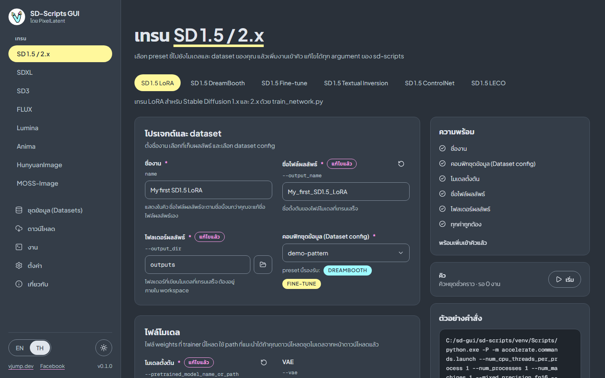

<p align="center">
  
</p>

<h1 align="center">SD-Scripts GUI</h1>

<p align="center">โดย PixelLatent</p>

<p align="center"><a href="README.md">English</a> | <a href="README.th.md">ภาษาไทย</a></p>

GUI แบบเว็บและเดสก์ท็อปสำหรับ [kohya-ss sd-scripts](https://github.com/kohya-ss/sd-scripts) ตั้งค่าการเทรน LoRA, fine-tune หรือแบบอื่นผ่านฟอร์ม ใส่คิว แล้วดูมันเทรน



## ฟีเจอร์

- **ครบทุก argument ของทุกสคริปต์เทรน** ฟอร์มสร้างจาก argument schema ของสคริปต์ sd-scripts (24 สคริปต์) จึงรองรับทุกโมเดลและทุกพารามิเตอร์ preset ที่คัดไว้ให้เป็นจุดเริ่มต้นที่ดี ส่วน **พารามิเตอร์ทั้งหมด** ให้ที่เหลือ พร้อมการค้นหาและตัวกรองเฉพาะที่แก้ไข
- **8 ตระกูลโมเดล 25 preset** LoRA, fine-tune, DreamBooth, Textual Inversion, ControlNet, ControlNet-LLLite และ LECO ดูตารางด้านล่าง
- **ตัวอย่างคำสั่ง** ดูคำสั่งจริงก่อนรัน ส่งออกและนำเข้าฟอร์มเป็นไฟล์ JSON config ได้
- **คิวงาน** รันทีละหนึ่งงาน และ **เริ่ม** แต่ละครั้งรันเพียงหนึ่งงาน มี log สด ความคืบหน้าตาม step และ epoch ดาวน์โหลดผลลัพธ์ทีละไฟล์หรือเป็น zip ยกเลิกแล้วปิด process tree ทั้งหมด ลองใหม่ และสลับลำดับ
- **เครื่องมือ dataset** อัปโหลดภาพพร้อม caption `.txt` ในเบราว์เซอร์ แก้ caption สร้าง dataset config (TOML) ผ่านฟอร์ม นำเข้า ส่งออก และตรวจสอบ
- **ดาวน์โหลดโมเดล** ชุดโมเดลจาก Hugging Face ที่ตรวจสอบแล้ว ลงใน workspace ในคลิกเดียว ไฟล์ที่มีอยู่แล้วจะถูกข้าม
- **ตัวติดตามระบบ** CPU, RAM, การใช้งาน GPU, VRAM และอุณหภูมิขณะงานรัน
- **รันได้ในที่ที่คุณเทรน** แอปเดสก์ท็อป Windows (`install.bat` กับ `run.bat` ไม่มี `.exe`) หรือ Docker image สำหรับ Runpod และ Vast.ai ที่มี JupyterLab มาด้วย
- หน้าจอ**ภาษาอังกฤษและไทย** ธีมสว่างและมืด
- **ค่าเริ่มต้นที่ปลอดภัย** การเขียนไฟล์ถูกจำกัดในโฟลเดอร์ workspace เดียว คำสั่งรันโดยไม่ผ่าน shell ข้อมูลลับอยู่ในหน่วยความจำเท่านั้น และตั้งรหัสผ่านป้องกันเซิร์ฟเวอร์ได้

## โมเดลและชนิดการเทรนที่รองรับ

| ตระกูล | LoRA | Fine-tune | DreamBooth | Textual Inversion | ControlNet | ControlNet-LLLite | LECO |
|---|:-:|:-:|:-:|:-:|:-:|:-:|:-:|
| SD 1.5 / 2.x | มี | มี | มี | มี | มี | | มี |
| SDXL | มี | มี | | มี | มี | มี | มี |
| SD3 | มี | มี | | | | | |
| FLUX (FLUX.1, Chroma) | มี | มี | | | มี | | |
| Lumina | มี | มี | | | | | |
| Anima | มี | มี | | | | มี | |
| HunyuanImage | มี | | | | | | |
| MOSS-Image | มี | | | | | | |

สคริปต์ของแต่ละ preset และไฟล์โมเดลที่ต้องใช้อยู่ใน[การเทรน](docs/th/training.md#preset-ของแต่ละตระกูล)

## เริ่มต้นใช้งาน

### เดสก์ท็อป Windows

ความต้องการ: Windows 10 หรือ 11 (64-bit), GPU NVIDIA พร้อม driver ที่รองรับ CUDA 12.8 และพื้นที่ดิสก์ว่างประมาณ 25 GB

1. ดาวน์โหลด `sd-scripts-gui-vX.Y.Z.zip` จาก [Releases](https://github.com/vjumpkung/vjump-sd-scripts-gui/releases) แล้วแตกไฟล์ไปไว้ใน path สั้น ๆ เช่น `C:\sd-gui`
2. ดับเบิลคลิก `install.bat` จะติดตั้ง uv, Python 3.12, sd-scripts และ PyTorch (CUDA 12.8) รันซ้ำได้อย่างปลอดภัย
3. ดับเบิลคลิก `run.bat` เพื่อเปิดแอปในหน้าต่างของตัวเอง ถ้าหน้าต่างไม่เปิด ให้ใช้ `run-browser.bat` ซึ่งจะเปิด `http://127.0.0.1:8000` ในเบราว์เซอร์

รายละเอียด: [ติดตั้งบน Windows](docs/th/install-windows.md)

### Cloud (Runpod, Vast.ai)

ใช้ image `ghcr.io/vjumpkung/vjump-sd-scripts-gui:latest`

| การตั้งค่า | ค่า |
|---|---|
| Port | `8000` (GUI), `8888` (JupyterLab) |
| Volume | mount ที่ `/workspace` |
| Environment | `SD_SCRIPTS_GUI_PASSWORD` (แนะนำ), `JUPYTER_PASSWORD`, `HF_TOKEN` (ไม่บังคับ) |

GUI ปลอดภัยตั้งแต่ค่าเริ่มต้น ถ้าไม่ตั้ง `SD_SCRIPTS_GUI_PASSWORD` container จะสร้างรหัสผ่านสุ่มทุกครั้งที่เริ่ม และแสดงใน log ของ container เป็น `GUI login: any username / password: ...` (แท็บ **Logs** ของ pod บน Runpod หรือ log ของ instance บน Vast.ai) ล็อกอินด้วยชื่อผู้ใช้อะไรก็ได้ Basic authentication เป็นข้อความธรรมดาบน `http://` จึงควรใช้ URL แบบ HTTPS การล็อกอินเท่ากับควบคุมเครื่องได้เต็มที่ เหมือน Jupyter

บน Runpod เปิด GUI ที่ `https://<POD_ID>-8000.proxy.runpod.net` รายละเอียด: [Cloud: Runpod และ Vast.ai](docs/th/cloud-runpod-vast.md)

## เอกสาร

| หน้า | หัวข้อ |
|---|---|
| [ภาพรวม](docs/th/index.md) | แอปคืออะไรและจัดโครงสร้างอย่างไร |
| [ติดตั้งบน Windows](docs/th/install-windows.md) | `install.bat`, `run.bat`, การอัปเดต |
| [Cloud: Runpod และ Vast.ai](docs/th/cloud-runpod-vast.md) | Docker image, port, รหัสผ่าน, JupyterLab |
| [เริ่มต้นใช้งาน](docs/th/quick-start.md) | เทรน LoRA ตัวแรก พร้อมภาพหน้าจอ |
| [ชุดข้อมูล (Datasets)](docs/th/datasets.md) | โฟลเดอร์ภาพ, caption, dataset config |
| [การเทรน](docs/th/training.md) | Preset, พารามิเตอร์, ตัวอย่างคำสั่ง, เคล็ดลับประหยัดหน่วยความจำ |
| [งาน](docs/th/jobs.md) | คิว, log, ผลลัพธ์ |
| [ดาวน์โหลด](docs/th/downloads.md) | ชุดโมเดลและโมเดลที่ต้องขอสิทธิ์ |
| [ตั้งค่า](docs/th/settings.md) | ข้อมูลลับ, Accelerate, environment |
| [แก้ปัญหา](docs/th/troubleshooting.md) | ข้อผิดพลาดที่พบบ่อย ไฟล์อยู่ที่ไหน |
| [API contract](docs/api.md) | API ของ backend (ภาษาอังกฤษ) สำหรับผู้พัฒนา |

เอกสารชุดเดียวกันเป็นภาษาอังกฤษ: [docs/en](docs/en/index.md)

## การพัฒนา

repository นี้มี backend แบบ FastAPI (`backend/`, Python 3.12, [uv](https://docs.astral.sh/uv/)) และ frontend แบบ React (`frontend/`, [pnpm](https://pnpm.io/)) ผู้ร่วมพัฒนาและ AI agent โปรดอ่าน [AGENTS.md](AGENTS.md) ก่อน

```bash
# backend
cd backend
uv sync --dev --extra desktop       # ต้องมี --extra desktop ไม่เช่นนั้น pywebview จะถูกถอดออก
uv run pytest
uv run ruff check . && uv run ruff format --check .
uv run uvicorn app.main:app --host 127.0.0.1 --port 8000 --workers 1

# frontend (ใน terminal ที่สอง)
cd frontend
pnpm install
pnpm dev                            # proxy /api ไปที่ http://127.0.0.1:8000
pnpm build                          # ตรวจชนิดข้อมูล แล้ว build ลง backend/web
pnpm format:check
```

ให้เปิดแอปผ่าน address ของ Vite ซึ่ง proxy `/api` ไปยัง backend: CORS ปิดไว้ตามค่าเริ่มต้น และ request ข้ามเว็บไซต์ไปยัง API จะถูกบล็อก รัน backend ด้วย worker เดียวเสมอ เพราะตัวรันคิวอยู่ในโปรเซสนั้น การเทรนต้องใช้ environment ของ sd-scripts ที่ `install.bat` สร้างไว้ (ดู `backend/README.md` สำหรับ environment variable) API contract ใน [docs/api.md](docs/api.md) คือแหล่งอ้างอิงหลักของทั้ง backend และ frontend

## ขั้นตอนการออก release

release เกิดจากการแก้ไฟล์ `VERSION` ที่ root ของ repository แล้ว push ขึ้น `main`

1. ใส่เวอร์ชันใหม่ใน `VERSION` (เช่น `0.2.0`)
2. merge เข้า `main` workflow `release` จะทำงานเมื่อ `VERSION` เปลี่ยน (หรือเมื่อสั่งรันเอง)
3. workflow จะ build และ push Docker image ไปที่ `ghcr.io/vjumpkung/vjump-sd-scripts-gui` (tag `X.Y.Z`, `X.Y`, `latest` และ commit) จากนั้น build ชุดสำหรับ Windows และเผยแพร่ GitHub release `vX.Y.Z` พร้อมไฟล์ `sd-scripts-gui-vX.Y.Z.zip` ถ้า tag นั้นมีอยู่แล้วจะไม่เผยแพร่อะไร

## เครดิต

- [kohya-ss/sd-scripts](https://github.com/kohya-ss/sd-scripts): ชุดเครื่องมือเทรน แอปนี้สร้างคำสั่ง ส่วนการเทรนจริงทำโดย sd-scripts
- [vjumpkung/sd-scripts](https://github.com/vjumpkung/sd-scripts) (branch `feat/vjump`): fork ที่แอปนี้พัฒนาควบคู่ไปด้วยและติดตั้งให้
- musubi-tuner-gui: ลำดับการใช้งานของแอปอ้างอิงจากโปรเจกต์นี้ ซึ่งสร้างโดยผู้พัฒนาคนเดียวกันสำหรับ kohya-ss musubi-tuner

## ติดต่อ

- Facebook: [facebook.com/pixellatent](https://www.facebook.com/pixellatent)
- อีเมล: [vjumpkung@gmail.com](mailto:vjumpkung@gmail.com)
- เว็บไซต์: [vjump.dev](https://vjump.dev)
- GitHub: [vjumpkung](https://github.com/vjumpkung)

## สัญญาอนุญาต

[Apache License 2.0](LICENSE)
