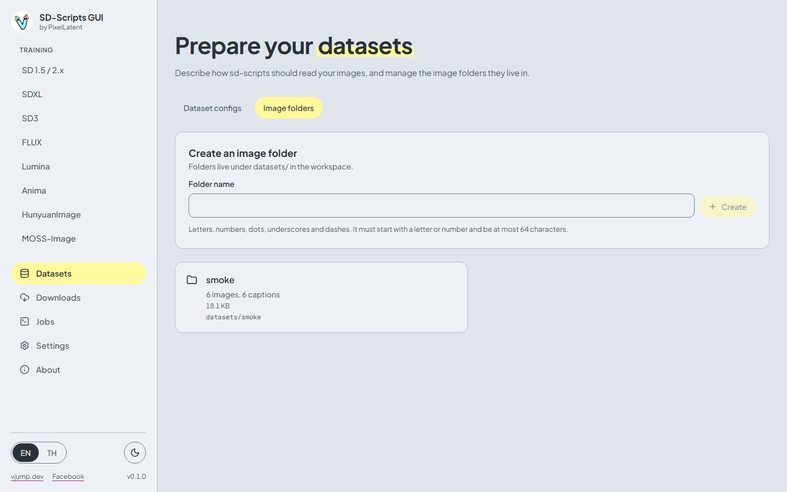
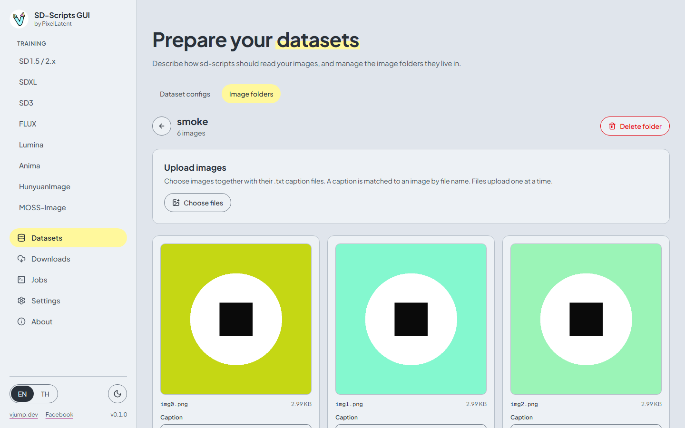
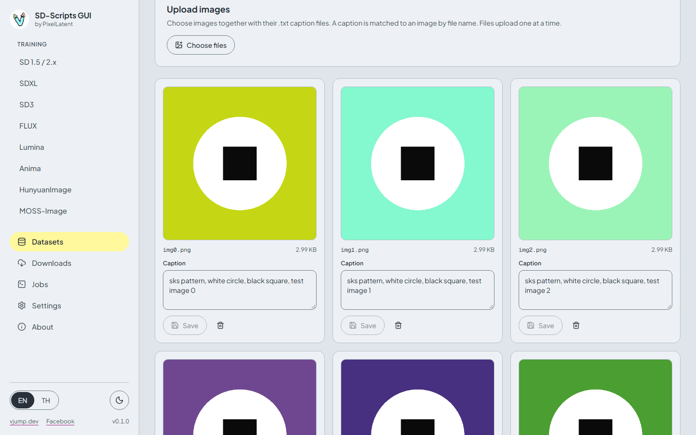
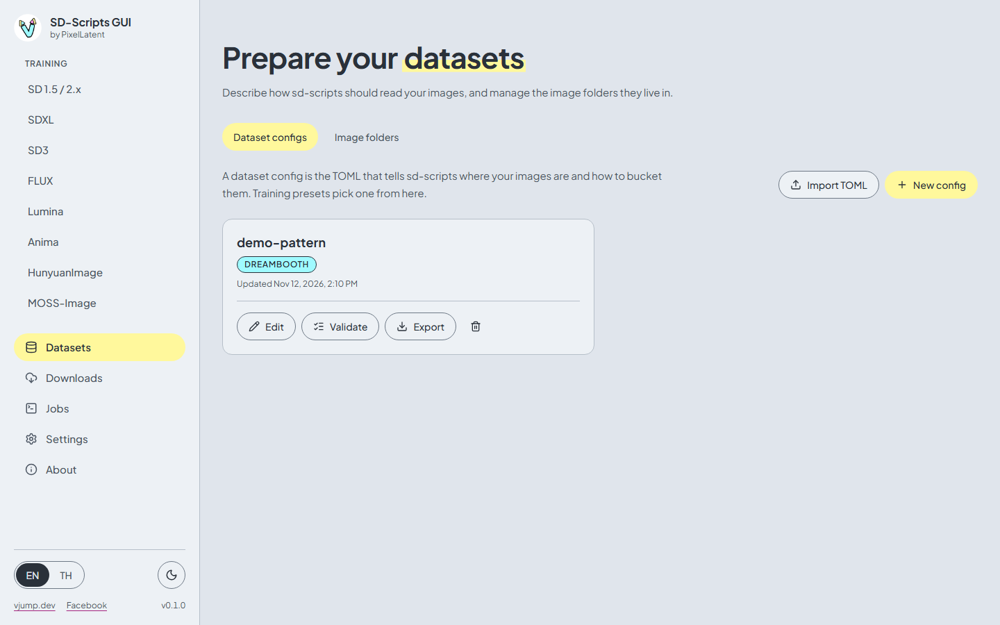
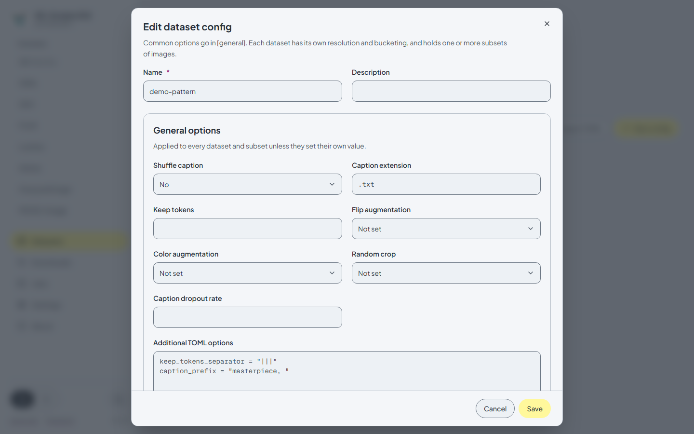
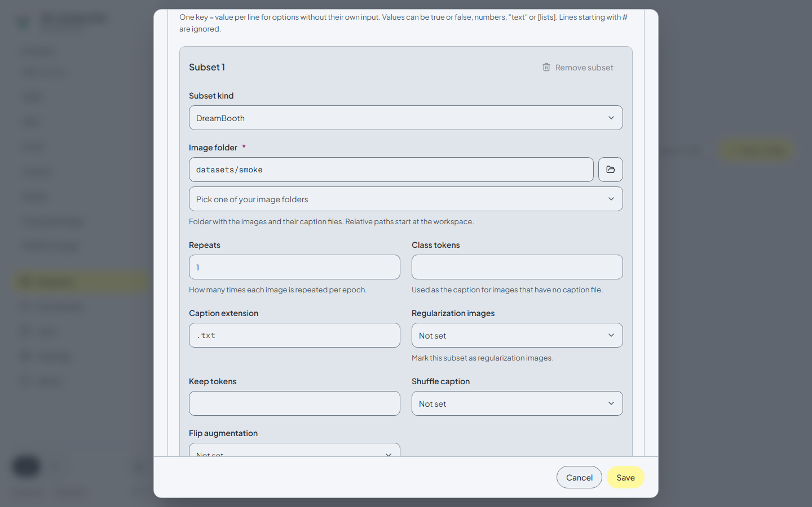
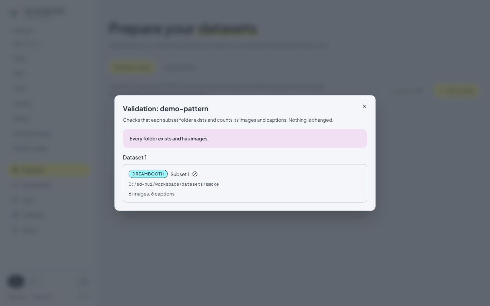

# Datasets

[English](datasets.md) | [ภาษาไทย](../th/datasets.md)

The **Datasets** page has two tabs. **Image folders** holds the images and captions. **Dataset configs** holds the TOML that tells sd-scripts how to read them. A training preset needs a dataset config (except LECO, which trains from text prompts only).

## Image folders

Image folders live under `workspace/datasets/`. A folder name uses letters, numbers, dots, underscores and dashes, starts with a letter or number, and has at most 64 characters.

**Create** a folder from the card at the top of the tab. Open a folder to see its images.

### Upload

1. Press **Choose files**, or drag files onto the upload card.
2. Select images (`.png`, `.jpg`, `.jpeg`, `.webp`, `.bmp`) together with their captions.
3. Press **Upload N images**.

Rules:

- A caption is a `.txt` **sidecar** with the same name as the image: `cat01.png` + `cat01.txt`. The browser reads the `.txt` files and sends each caption with its image.
- Caption files without a matching image, and files of other types, are skipped. The page tells you how many.
- Files upload **one at a time**, which keeps each request small for cloud proxies. You cannot leave the page while an upload runs. **Cancel upload** stops it.
- Uploading a file with an existing name overwrites it. The limit per file is 2 GiB.
- Deleting an image also deletes its `.txt` file. Deleting a folder deletes everything in it, and is refused while a queued or running job uses that folder.

### Edit captions

Each thumbnail has a **Caption** box. Type the new caption and press the save button. Images without a caption show **none**. The page shows 48 images at a time: press **Show N more** for the rest.

## Dataset configs

A dataset config is the sd-scripts dataset TOML: a `[general]` section, one or more `[[datasets]]`, and `[[datasets.subsets]]` inside each.

| Button | Action |
|---|---|
| **New config** | Open the editor with an empty config |
| **Import TOML** | Create a config from a `.toml` file (up to 1 MB). An invalid file is rejected with the reason |
| **Edit** | Change a config |
| **Validate** | Check the folders without changing anything (below) |
| **Export** | Download the config as a `.toml` file |
| trash icon | Delete the config. Jobs that already used it keep their own copy |

### The editor

| Level | What it controls |
|---|---|
| **General options** | Applies to every dataset and subset unless they set their own value: **Shuffle caption**, **Caption extension** (new configs start with `.txt`), **Keep tokens**, **Flip augmentation**, **Color augmentation**, **Random crop**, **Caption dropout rate** |
| **Dataset N** | **Resolution** (width x height), **Batch size**, **Enable bucketing**, **Bucket no upscale**, min and max bucket resolution, bucket resolution steps |
| **Subset N** | One source of images: its folder, **Repeats**, and options that override the levels above |

A selector set to **Not set** leaves the key out of the TOML, so the sd-scripts default (or the level above) applies. Press **Add dataset** or **Add subset** for more than one. A config can hold several datasets, and a dataset several subsets.

### Subset kinds

Choose the **Subset kind**. It decides which fields appear, and which training presets accept the config.

| Kind | Fields | Used by |
|---|---|---|
| **DreamBooth** | **Image folder**, **Repeats**, **Class tokens**, **Caption extension**, **Regularization images** | Most presets, and the only kind the DreamBooth preset accepts |
| **Fine-tune (metadata file)** | **Metadata file** (a JSON file with the captions), optional **Image folder**, **Repeats** | Fine-tune and most LoRA presets. The SD 1.5 fine-tune preset accepts only this kind |
| **ControlNet** | **Image folder**, **Conditioning image folder** (control images that pair with the training images), **Repeats** | ControlNet and ControlNet-LLLite presets, which accept only this kind |

The kind is not stored as such: sd-scripts derives it from the keys present (`metadata_file` makes it fine-tune, `conditioning_data_dir` makes it ControlNet). Do not mix DreamBooth and fine-tune subsets inside one dataset. The column **Dataset kinds** in the [preset table](training.md#presets-per-family) lists what each preset accepts. The training page shows the same next to the **Dataset config** field, and only offers compatible configs.

Paths can be relative to the workspace (`datasets/cat`) or absolute. Use **Pick one of your image folders** to fill the folder from the list.

### Captions

**Caption extension** is the extension of the caption files. Image folders store captions as `.txt`, so keep `.txt`. sd-scripts itself defaults to `.caption`, so a config without the key would ignore your captions.

**Class tokens** are used as the caption of images that have no caption file.

### Additional TOML options

Any key without its own input goes in **Additional TOML options**: one `key = value` per line. Values can be `true` or `false`, numbers, `"text"` or `[lists]`. Lines starting with `#` are ignored. Keys the backend does not know are saved, and listed as **Warnings from the backend** instead of blocking the save.

### Validate

**Validate** opens a report with, for each subset: whether the folder exists, how many images and captions it holds, and the first images without a caption.

The check passes when every folder exists and holds at least one image. Captions are counted with the subset's effective caption extension.

## Next

Use the config on the [Training](training.md) page.
