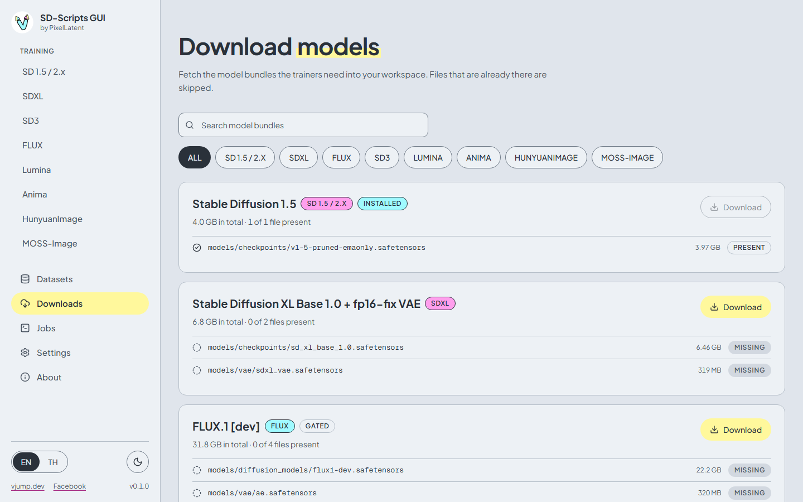

# Downloads

[English](downloads.md) | [ภาษาไทย](../th/downloads.md)

The **Downloads** page fetches the model files the trainers need straight from Hugging Face into your workspace. It offers a fixed catalog of verified bundles. It does not download arbitrary URLs.

## The catalog

Each card is a bundle: a name, a family badge, the total size, and the list of its files with **Present** or **Missing** next to each. A bundle whose files are all present shows **Installed**.

| ID | Name | Family | Size | Files | Gated |
|---|---|---|---|---|---|
| `sd15` | Stable Diffusion 1.5 | SD 1.5 / 2.x | 4.0 GB | 1 | no |
| `sdxl-base` | Stable Diffusion XL Base 1.0 + fp16-fix VAE | SDXL | 6.8 GB | 2 | no |
| `flux1-dev` | FLUX.1 [dev] | FLUX | 31.8 GB | 4 | yes |
| `flux-text-encoders-fp8` | FLUX T5-XXL fp8 (low VRAM, optional) | FLUX | 4.6 GB | 1 | no |
| `chroma1-base` | Chroma1-Base | FLUX | 26.0 GB | 3 | no |
| `sd35-large` | Stable Diffusion 3.5 Large | SD3 | 26.0 GB | 4 | yes |
| `sd35-medium` | Stable Diffusion 3.5 Medium | SD3 | 15.4 GB | 4 | yes |
| `lumina2` | Lumina Image 2.0 | Lumina | 10.0 GB | 3 | no |
| `anima` | Anima base v1.0 | Anima | 5.2 GB | 3 | no |
| `hunyuan-image-2.1` | HunyuanImage 2.1 | HunyuanImage | 49.1 GB | 4 | no |
| `moss-image` | MOSS-Image Base | MOSS-Image | 25.3 GB | 8 | no |

Sizes are the totals shown on the cards. Use **Search model bundles** or the family chips to filter.

## Download a bundle

1. Press **Download** on the card. A progress bar shows the current file.
2. Press **Cancel** to stop. Files that already finished are kept.
3. When the card says **Installed**, the model is ready for the **Use suggested** button on the training page.

Details:

- Files go into `workspace/models/...`, in the folders the presets expect: `models/checkpoints`, `models/diffusion_models`, `models/text_encoders`, `models/vae` and, for MOSS-Image, `models/moss_image`.
- **Files that are already present with the expected size are skipped.** Several bundles share files (for example `models/vae/ae.safetensors` and the T5-XXL text encoder), so a second bundle often downloads less than its total.
- Two downloads that would write the same file at the same time are refused.
- The download list lives in the running app only. If you close the app mid-download, press **Download** again: finished files are skipped.
- Bundles are large. Check your free disk space first.

## Gated models

**FLUX.1 [dev]**, **Stable Diffusion 3.5 Large** and **Stable Diffusion 3.5 Medium** are **Gated**: Hugging Face only gives the files to accounts that accepted the model's license. You need two things.

1. **Accept the license.** Sign in at [huggingface.co](https://huggingface.co), open the model page ([FLUX.1-dev](https://huggingface.co/black-forest-labs/FLUX.1-dev), [SD 3.5 Large](https://huggingface.co/stabilityai/stable-diffusion-3.5-large), [SD 3.5 Medium](https://huggingface.co/stabilityai/stable-diffusion-3.5-medium)), and accept the terms.
2. **Add a token.** Create an access token with read permission at [huggingface.co/settings/tokens](https://huggingface.co/settings/tokens). In the app open **Settings**, paste it into **Hugging Face token**, and press **Save**. The gated card links there too (**Add a token in Settings**).

Without both, the download fails with HTTP 401 or 403: see [Troubleshooting](troubleshooting.md). The token is kept in the memory of the app only and is never written to disk (see [Settings](settings.md)). The same token is passed to training runs as `HF_TOKEN`.

The other bundles are not gated and need no token.

## Using your own models

The catalog is only a convenience. Any model file you place in the workspace works: copy it into `workspace/models/` and pick it with **Browse** in **Model files**. On the desktop app you can pick a file from anywhere on your disk.
