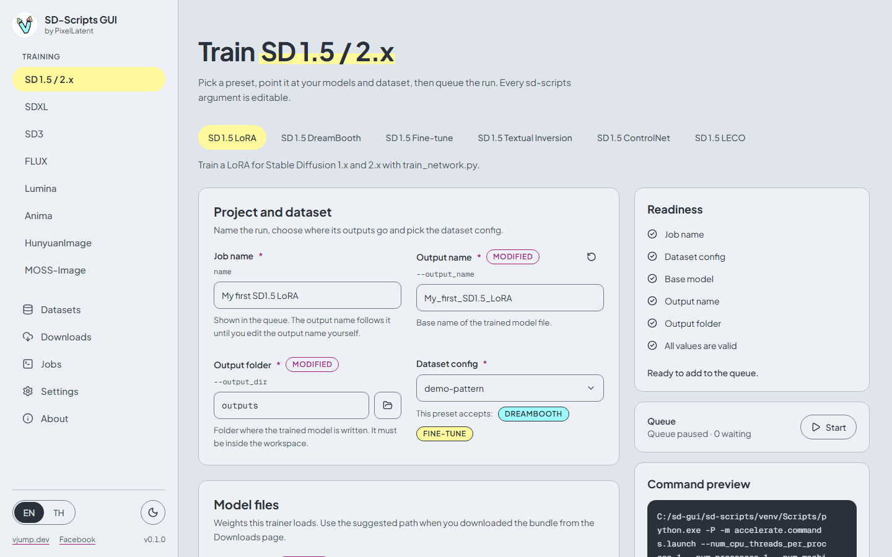
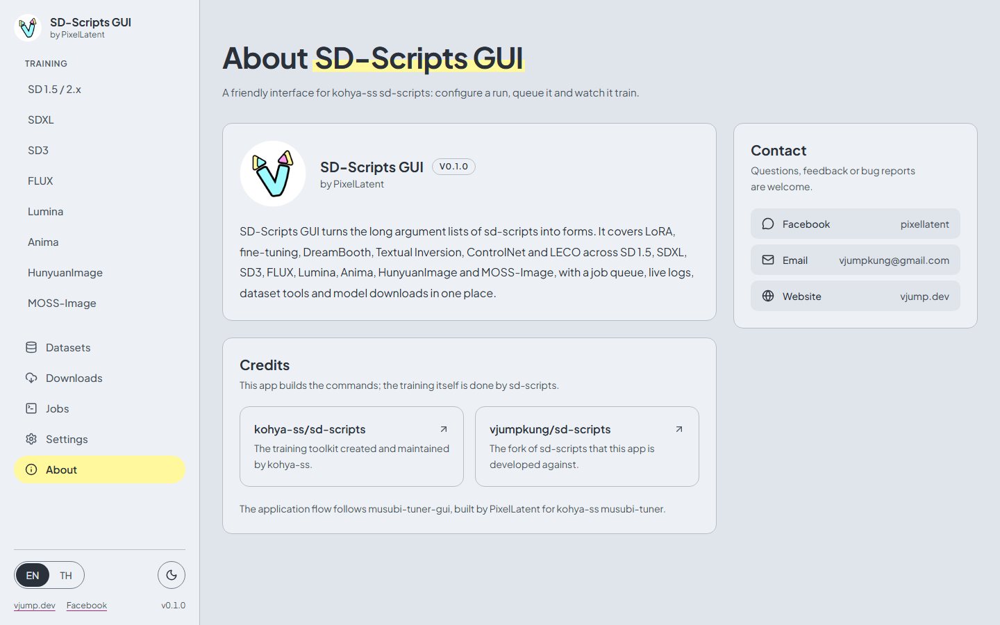
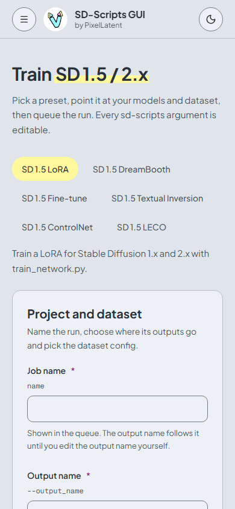

# SD-Scripts GUI documentation

[English](index.md) | [ภาษาไทย](../th/index.md)

SD-Scripts GUI is a web and desktop interface for [kohya-ss sd-scripts](https://github.com/kohya-ss/sd-scripts). It turns the long argument lists of the 24 sd-scripts training scripts into forms, queues the runs, and shows live logs and results. The training itself is done by sd-scripts.

## Page map

| Page | What it covers |
|---|---|
| [Install on Windows](install-windows.md) | Requirements, `install.bat`, `run.bat`, `run-browser.bat`, updating, uninstalling |
| [Cloud: Runpod and Vast.ai](cloud-runpod-vast.md) | The Docker image, ports, environment variables, password, JupyterLab |
| [Quick start](quick-start.md) | Your first LoRA, end to end, with screenshots |
| [Datasets](datasets.md) | Image folders, captions, dataset configs (TOML) |
| [Training](training.md) | Presets, model files, parameters, command preview, memory tips |
| [Jobs](jobs.md) | The queue, logs, progress, outputs, cancel and retry |
| [Downloads](downloads.md) | The model bundle catalog and gated models |
| [Settings](settings.md) | Secrets, Accelerate, the sd-scripts environment, language and theme |
| [Troubleshooting](troubleshooting.md) | Common errors and where files live |

## How the app is organized

The sidebar has one entry per model family under **Training**, followed by five pages.

| Sidebar entry | Purpose |
|---|---|
| **Training** > SD 1.5 / 2.x, SDXL, SD3, FLUX, Lumina, Anima, HunyuanImage, MOSS-Image | One page per model family. Each has tabs for its presets (LoRA, Fine-tune, DreamBooth, ...) |
| **Datasets** | Two tabs: **Dataset configs** (the TOML that tells sd-scripts where images are) and **Image folders** (upload images and captions) |
| **Downloads** | One-click model bundles into the workspace |
| **Jobs** | The queue, live log, progress, outputs and a system monitor |
| **Settings** | Hugging Face and W&B secrets, Accelerate launch options, sd-scripts environment, language, theme |
| **About** | Version, credits, contact |

The usual path through the app is: **Downloads** (get a model) → **Datasets** (images and a dataset config) → **Training** (fill the form, **Add to queue**) → **Jobs** (**Start**, watch, download).

The **About** page shows the version, the credits and the ways to contact the author.

## On a narrow screen

On a phone or a narrow window the sidebar moves behind the menu button and the columns of the training page stack. This is handy when the app runs in the cloud.

## Where things live

All models, datasets, outputs and logs live in one **workspace** folder. The app never writes outside it.

| Folder | Content |
|---|---|
| `workspace/models/` | Downloaded model files |
| `workspace/datasets/` | Image folders |
| `workspace/outputs/` | Trained LoRA and checkpoint files |
| `workspace/logs/` | A place for TensorBoard logs (type `logs` in the **Logging folder** field) |
| `backend/data/` | Job history and dataset configs (a SQLite database) and one folder per job with its log. In the Docker image: `/workspace/.sd-scripts-gui` |

The workspace is `<install folder>\workspace` on Windows and `/workspace` in the Docker image.

## Languages

The interface comes in English and Thai. Switch with the **EN | TH** toggle at the bottom of the sidebar, or in **Settings**. This documentation is available in both languages, and the screenshots follow the language of the page.

## Contact

Questions, feedback and bug reports are welcome: [Facebook page](https://www.facebook.com/pixellatent), [vjumpkung@gmail.com](mailto:vjumpkung@gmail.com), [vjump.dev](https://vjump.dev), or [GitHub issues](https://github.com/vjumpkung/vjump-sd-scripts-gui/issues).
