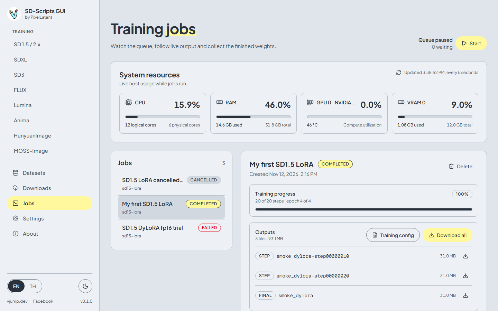
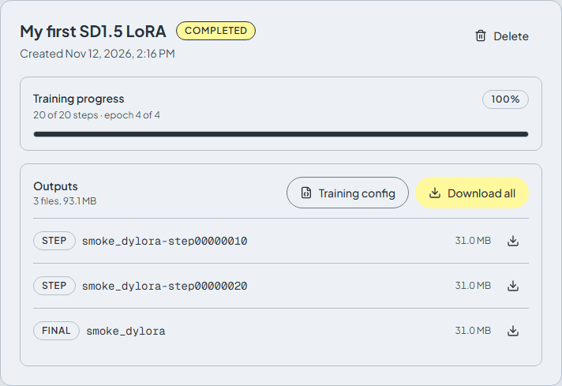
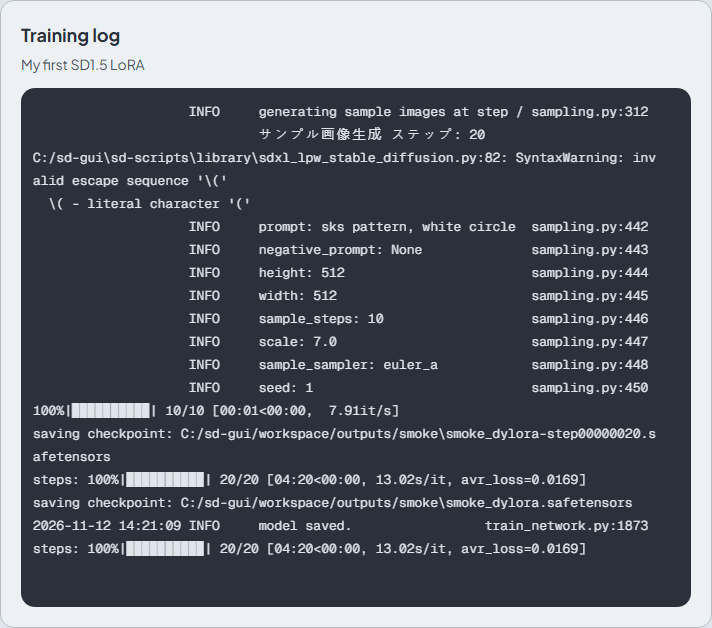

# Jobs

[English](jobs.md) | [ภาษาไทย](../th/jobs.md)

The **Jobs** page shows the queue, the live log of the selected job, its progress and its outputs, and a monitor of your CPU, RAM and GPU.

## The queue

**Add to queue** on a training page creates a job in status **Queued**. Jobs run one at a time, in the order of their queue position.

The queue starts **paused**, so adding a job never starts training by itself. The **Start** button (on this page, and in the **Queue** card of every training page) starts the queue. **Start runs exactly one job**: when it finishes, whether it completed, failed or was cancelled, the queue pauses again. To run the next queued job, press **Start** again. This is on purpose, so you can look at each result before the next run uses the GPU.

- **Pause** only stops the queue from starting the next job. It does not stop a job that is running. Use **Cancel** for that.
- Queued jobs show **queue #N**. The up and down arrows (**Move up in the queue**, **Move down in the queue**) change the order.
- If the app is closed or restarts while a job runs, that job becomes **Failed** with the error `Interrupted by server restart`.

| Status | Meaning |
|---|---|
| **Queued** | Waiting for its turn |
| **Running** | Training is in progress |
| **Completed** | Finished without error |
| **Failed** | The script stopped with an error. The last 20 lines of the log are kept as the error |
| **Cancelled** | You stopped it |

## Selecting a job

Click a job in the list. The right side shows its name, creation time, buttons, progress, outputs, and the log below them.

| Button | Available for | Effect |
|---|---|---|
| **Cancel** | Queued and running jobs | Stops the job. The whole training process tree is killed, including the children that sd-scripts started. A confirmation dialog asks first |
| **Retry** | Failed and cancelled jobs | Creates a new queued job with the same settings and dataset snapshot |
| **Delete** | Finished jobs | Removes the job and its log. Saved weights in the output folder are never deleted |

Each job keeps its own copy of the dataset TOML, so editing or deleting a dataset config later does not change a job that already exists, and **Retry** uses the old copy.

## Progress

The progress bar shows **N of M steps** and **epoch X of Y**. It is read from the log: the step counter of sd-scripts (the line that starts with `steps:`) and its `epoch X/Y` line. Until the first training step, it says **Waiting for the first training step**. Caching latents and similar steps before that are not counted.

## Training log

The **Training log** is the live output of the script, shown in a terminal-style view with colors and progress bars. You can scroll and select text. A finished job keeps its log until you delete the job. When a job fails, the end of the log holds the reason: see [Troubleshooting](troubleshooting.md).

Secrets such as the Hugging Face token are removed from the log.

## Outputs

The **Outputs** card lists the files written to the job's output folder:

| Kind | File name | What it is |
|---|---|---|
| **final** | `<output name>.safetensors` | The finished model |
| **epoch** | `<output name>-000005.safetensors` | A checkpoint saved at the end of an epoch |
| **step** | `<output name>-step00000100.safetensors` | A checkpoint saved every N steps |

- The download icon on a row downloads that file.
- **Download all** downloads every output as one `.zip` file.
- **Training config** downloads the settings of the job as a JSON file. You can load it again with **Import config** on a training page.

Files appear while the job runs, so you can download a checkpoint before training ends. They are also on disk in `workspace/outputs/`.

## System resources

The monitor at the top shows CPU, RAM, and for each GPU its utilization, VRAM and temperature. It updates every 5 seconds. It is useful to see how close a run is to your VRAM limit. If no GPU metrics are available, it says so.
