# Quick start: your first LoRA

[English](quick-start.md) | [ภาษาไทย](../th/quick-start.md)

This walks through one SD 1.5 LoRA from an empty workspace to a finished file. It assumes the app is installed and running ([Windows](install-windows.md) or [cloud](cloud-runpod-vast.md)). The screenshots use a small demo dataset of six images.

You need: a folder of images (10 to 30 is plenty for a first try), ideally each with a caption in a `.txt` file of the same name (`cat01.png` + `cat01.txt`).

## 1. Download a model

Open **Downloads** and press **Download** on **Stable Diffusion 1.5** (about 4 GB). Progress shows on the card. Models land in `workspace/models/`. A card that says **Installed** is ready.

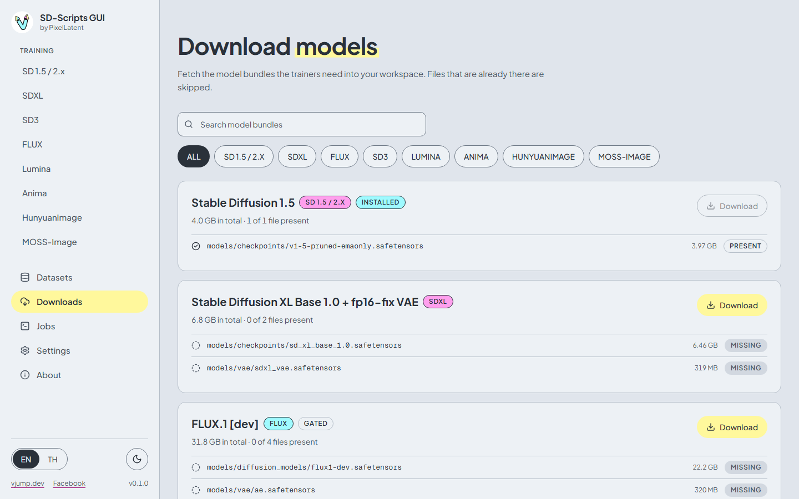

More about bundles and gated models: [Downloads](downloads.md).

## 2. Upload your images

Open **Datasets**, then the **Image folders** tab. Create a folder (letters, numbers, dots, underscores and dashes, up to 64 characters), then open it.

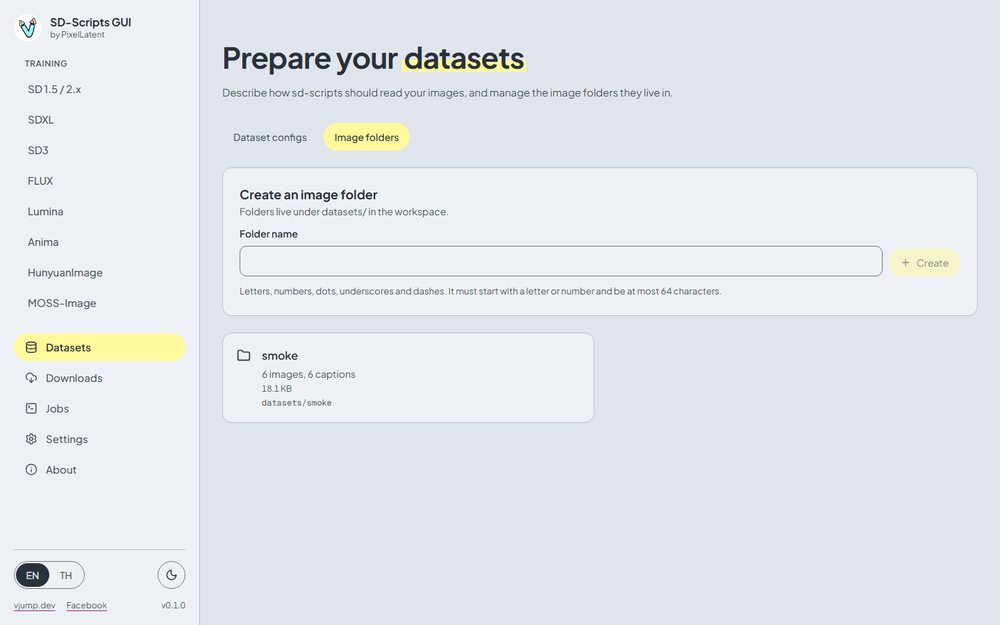

Press **Choose files** and pick your images together with their `.txt` captions. The page pairs each caption with its image by file name and tells you how many images, captions and unmatched files it found. Press **Upload N images**. Files upload one at a time.

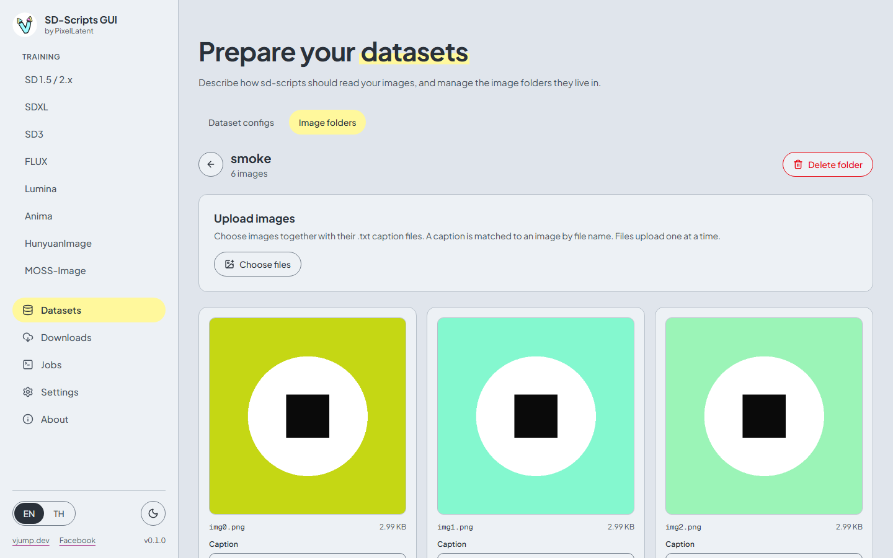

Each image shows its caption underneath. Edit a caption in place and save it. See [Datasets](datasets.md) for details.

## 3. Create a dataset config

A dataset config is the small TOML file that tells sd-scripts where the images are and how to bucket them. Open the **Dataset configs** tab and press **New config**.

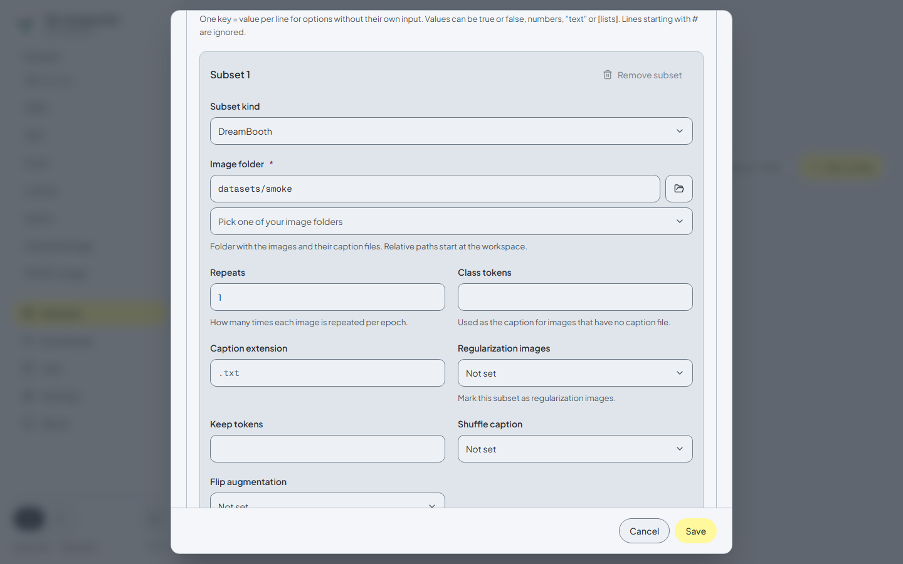

1. Give it a **Name**.
2. In **General options**, **Caption extension** is already `.txt`, which matches the caption files you uploaded.
3. In **Dataset 1**, set the **Resolution** (512 x 512 for SD 1.5).
4. In **Subset 1**, pick your image folder and set **Repeats**.
5. Press **Save**.

Press **Validate** on the card to check that the folder exists and to count the images and captions.

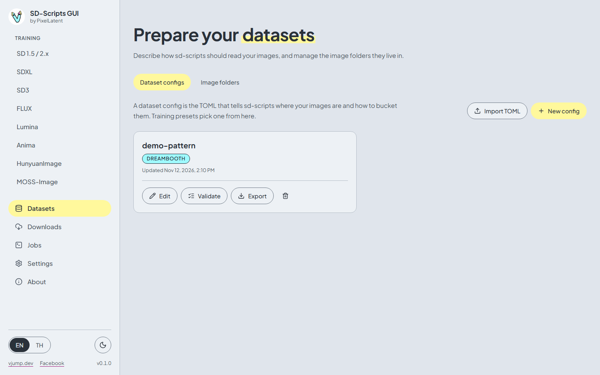

## 4. Fill in the training form

Open **Training > SD 1.5 / 2.x** and keep the **SD 1.5 LoRA** tab.

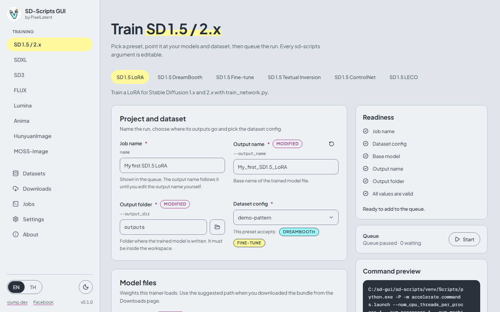

1. **Job name**: any name you like. The output file name follows it.
2. **Dataset config**: choose the config from step 3.
3. **Model files > Base model**: press **Use suggested**. The badge says **Installed** when step 1 is done.

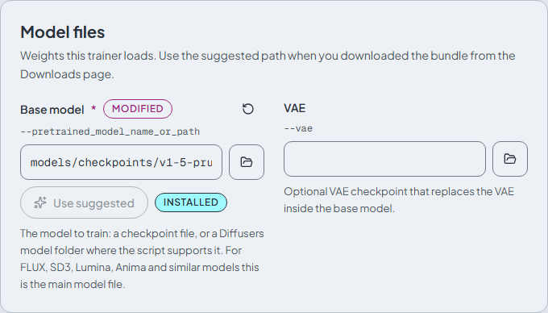

The defaults are a reasonable start: network rank 16, learning rate 1e-4, 10 epochs, AdamW8bit. Under **Memory and speed** set **Mixed precision** to `bf16` if you have an RTX 30xx or newer GPU. See [Training](training.md) for every section.

## 5. Add it to the queue

The **Readiness** list on the right shows what is still missing. When it says **Ready to add to the queue.**, press **Add to queue**. The **Command preview** shows the exact command that will run.

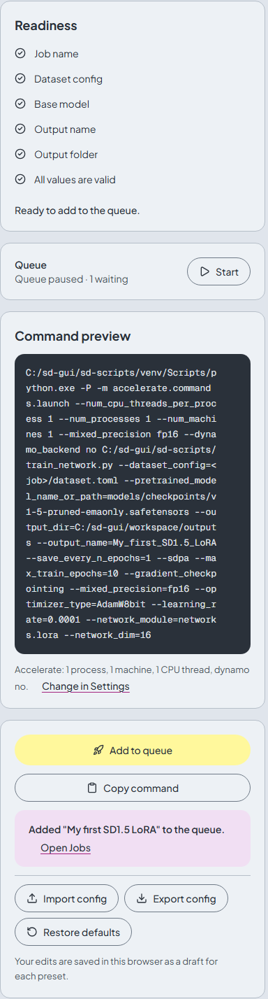

The queue starts **paused**, so nothing runs yet.

## 6. Start the job

Open **Jobs** and press **Start**. Exactly one job runs, and the queue pauses again when it ends, so you stay in control. Select your job in the list to follow it.

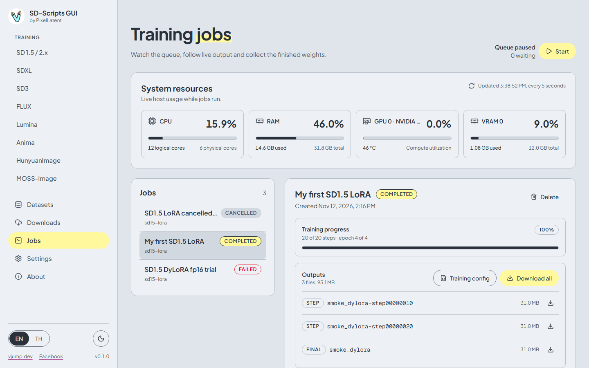

The **Training log** streams the output of sd-scripts live. Progress shows steps and epochs.

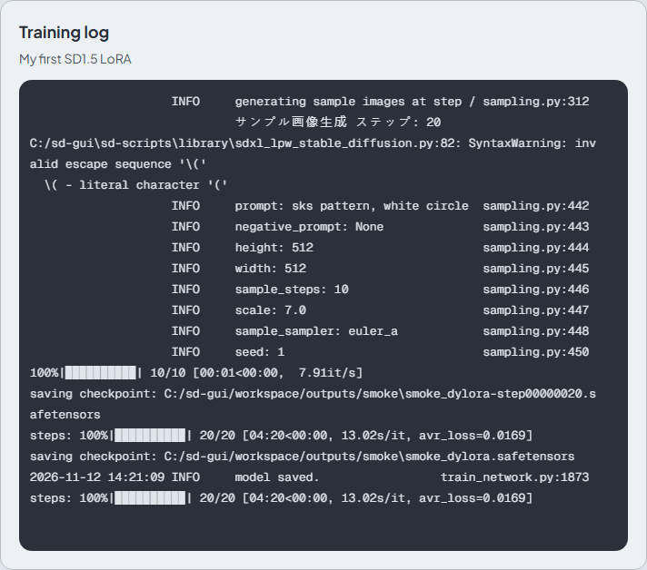

Press **Cancel** to stop a job. The whole training process tree is killed. See [Jobs](jobs.md).

## 7. Get the result

When the job is **Completed**, the **Outputs** card lists the files: **final** is the finished LoRA, **epoch** and **step** files are checkpoints saved on the way. Press the download icon of a file, or **Download all** for a zip.

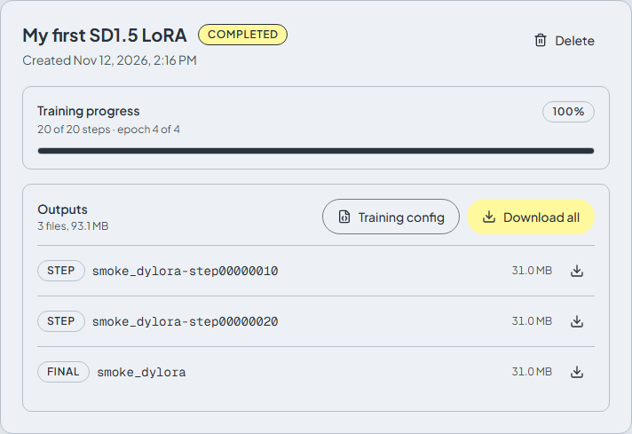

The files are also in `workspace/outputs/`. Copy the `.safetensors` file to the LoRA folder of the program you generate images with.

If the job fails, the log ends with the reason: see [Troubleshooting](troubleshooting.md).
