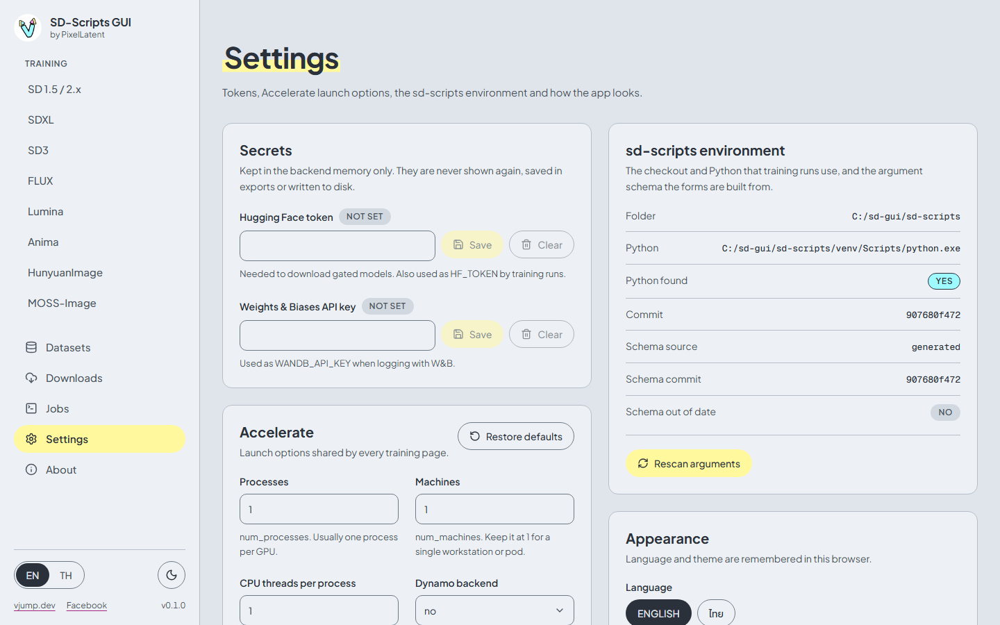
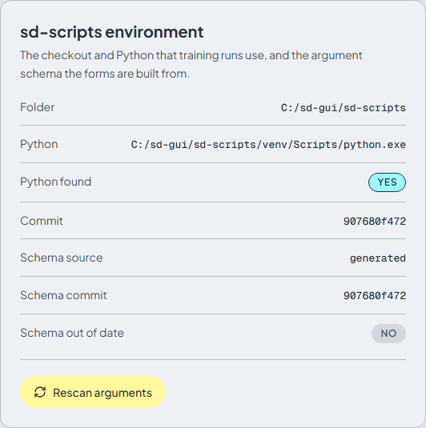

# Settings

[English](settings.md) | [ภาษาไทย](../th/settings.md)

## Secrets

| Field | Used for |
|---|---|
| **Hugging Face token** | Downloading [gated models](downloads.md#gated-models). It is also passed to every training run as `HF_TOKEN` |
| **Weights & Biases API key** | Passed to training as `WANDB_API_KEY`, for runs that log with W&B (set **Logging tool** in the training form) |

Type the value and press **Save**. A badge shows **Set** or **Not set**. A saved value is never shown again: the box stays empty and says **A value is set. Type to replace it.** Press **Clear** to remove it.

Secrets are kept **in the memory of the app only**. They are never written to disk, never included in exported configs, never shown in the API, and removed from logs and error messages. The price is that they are forgotten when the app stops. On Windows, enter them again after each start. In the Docker image, set the `HF_TOKEN` and `WANDB_API_KEY` environment variables to have them loaded at every start (see [Cloud](cloud-runpod-vast.md)).

## Accelerate

Launch options of `accelerate`, shared by every training page. The defaults suit a single GPU and should rarely change.

| Option | Flag | Default |
|---|---|---|
| **Processes** | `--num_processes` | 1 (usually one per GPU) |
| **Machines** | `--num_machines` | 1 |
| **CPU threads per process** | `--num_cpu_threads_per_process` | 1 |
| **Dynamo backend** | `--dynamo_backend` | `no`: turns `torch.compile` off, the safest choice. Others: `eager`, `aot_eager`, `inductor` |

Changes are saved automatically in this browser. An invalid number is highlighted and falls back to 1 when you add a job. **Restore defaults** resets all four. The current values show under the **Command preview** of each training page.

## sd-scripts environment

| Row | Meaning |
|---|---|
| **Folder** | The sd-scripts checkout that runs the training |
| **Python** | The Python of its virtual environment |
| **Python found** | **Yes** when that Python exists. If it says **No**, the **sd-scripts is not installed** banner shows on training pages: run `install.bat` or use the Docker image |
| **Commit** | The git commit of the checkout |
| **Schema source** | `generated` (made from your checkout) or `bundled` (shipped with the app) |
| **Schema commit** | The sd-scripts commit the argument forms were built from |
| **Schema out of date** | **Yes** when the schema commit differs from the checkout's commit |

The forms of the training pages are built from an **argument schema**: a list of every argument of every sd-scripts script. When you update sd-scripts (for example with `UPDATE=1 install.bat`), the arguments may change. The app then shows a banner on the other pages: *The argument schema was generated from a different sd-scripts commit than the one installed.* Press **Open Settings to rescan**, or press **Rescan arguments** here. It reads the arguments from the installed sd-scripts in the background (**Rescanning...**), and the forms update when it ends. Until then the bundled schema is used. If a rescan fails, the error is shown under the button.

## Appearance

**Language** (English or ไทย) and **Theme** (**System**, **Light**, **Dark**). Both are remembered in this browser. The same two switches are at the bottom of the sidebar.

## Workspace and access

**Workspace folder** shows where models, datasets, outputs and logs live. All writes stay inside it. **Password protection** shows **On** or **Off**. In the Docker image it is **On** by default, with a generated or chosen password (see [Cloud](cloud-runpod-vast.md#password)). When it is off, anyone who can reach the address can use the app: set `SD_SCRIPTS_GUI_PASSWORD` on the server to require a password. The desktop app listens on this computer only.

## Security model

- **Logging in to the app means full control of the machine**, the same as Jupyter: it can run training commands and read and write files in the workspace. Protect the address and the password accordingly.
- **Model files can contain code.** Load models only from sources you trust.
- **Write paths are confined to the workspace.** Output, log and cache folders cannot point outside it, and not into the app's own data folder either. This guards against mistakes. It is not a sandbox.
- **Import only training configs you trust.** For example, `resume_from_huggingface` downloads and loads a training state.
- **Cross-site requests to the API are blocked**, so a web page you have open in another tab cannot drive the app.
- Secrets stay in memory only (see [Secrets](#secrets)). On a plain `http://` address, Basic authentication sends the password in clear text: prefer HTTPS.
