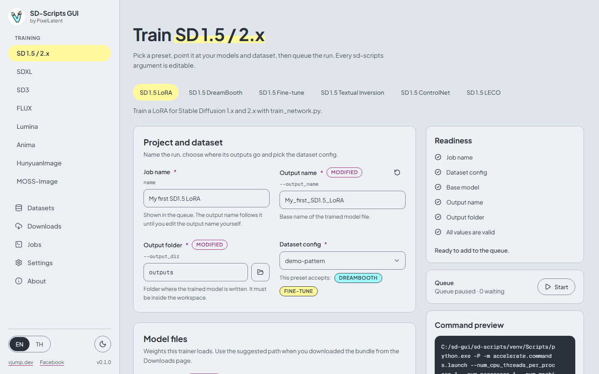
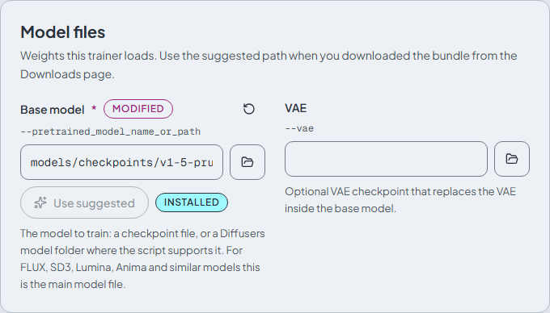
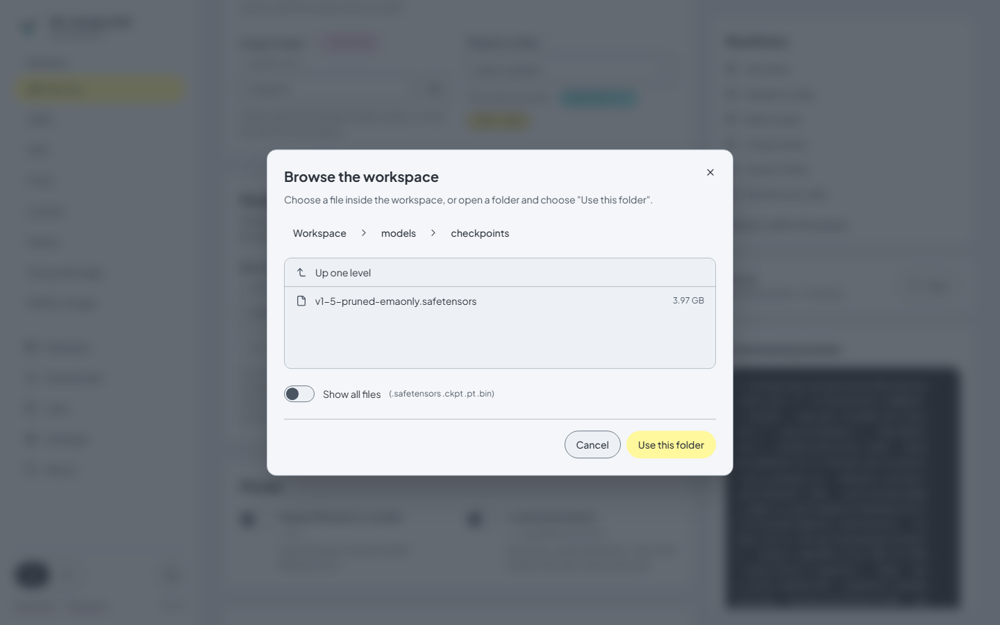
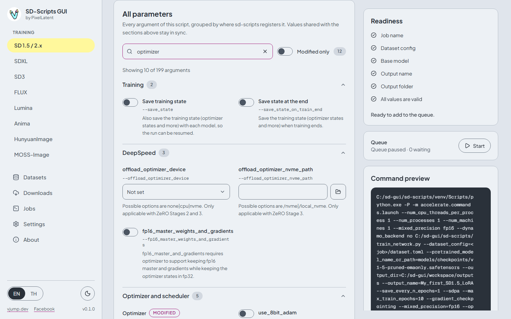
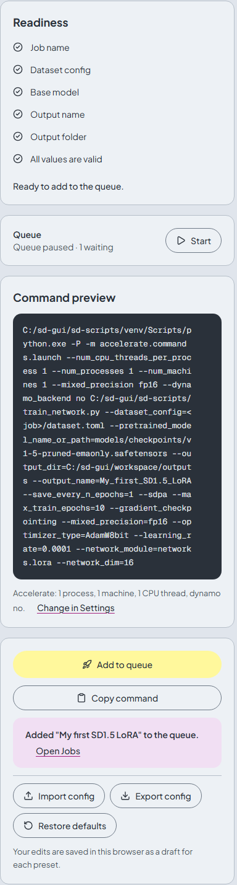

# Training

[English](training.md) | [ภาษาไทย](../th/training.md)

Every model family has its own page under **Training** in the sidebar. A page shows one tab per **preset**. A preset is a curated starting point for one sd-scripts script: it knows the model files the script needs, sensible defaults, and which dataset kinds it accepts. Every argument of the script stays editable.



## Presets per family

8 families and 25 presets. "Required model files" are the **Model files** that must be set before a job can be added.

| Family | Preset | Script | Dataset kinds | Required model files |
|---|---|---|---|---|
| SD 1.5 / 2.x | SD 1.5 LoRA | `train_network.py` | DreamBooth, Fine-tune | Base model |
| SD 1.5 / 2.x | SD 1.5 DreamBooth | `train_db.py` | DreamBooth | Base model |
| SD 1.5 / 2.x | SD 1.5 Fine-tune | `fine_tune.py` | Fine-tune | Base model |
| SD 1.5 / 2.x | SD 1.5 Textual Inversion | `train_textual_inversion.py` | DreamBooth, Fine-tune | Base model |
| SD 1.5 / 2.x | SD 1.5 ControlNet | `train_control_net.py` | ControlNet | Base model |
| SD 1.5 / 2.x | SD 1.5 LECO | `train_leco.py` | none (prompts only) | Base model |
| SDXL | SDXL LoRA | `sdxl_train_network.py` | DreamBooth, Fine-tune | Base model |
| SDXL | SDXL Fine-tune | `sdxl_train.py` | DreamBooth, Fine-tune | Base model |
| SDXL | SDXL Textual Inversion | `sdxl_train_textual_inversion.py` | DreamBooth, Fine-tune | Base model |
| SDXL | SDXL ControlNet | `sdxl_train_control_net.py` | ControlNet | Base model |
| SDXL | SDXL ControlNet-LLLite | `sdxl_train_control_net_lllite.py` | ControlNet | Base model |
| SDXL | SDXL LECO | `sdxl_train_leco.py` | none (prompts only) | Base model |
| SD3 | SD3 LoRA | `sd3_train_network.py` | DreamBooth, Fine-tune | Base model |
| SD3 | SD3 Fine-tune | `sd3_train.py` | DreamBooth, Fine-tune | Base model |
| FLUX | FLUX.1 LoRA | `flux_train_network.py` | DreamBooth, Fine-tune | Base model, CLIP-L text encoder, T5-XXL text encoder, Autoencoder (AE) |
| FLUX | Chroma LoRA | `flux_train_network.py` | DreamBooth, Fine-tune | Base model, T5-XXL text encoder, Autoencoder (AE) |
| FLUX | FLUX.1 Fine-tune | `flux_train.py` | DreamBooth, Fine-tune | Base model, CLIP-L text encoder, T5-XXL text encoder, Autoencoder (AE) |
| FLUX | FLUX.1 ControlNet | `flux_train_control_net.py` | ControlNet | Base model, CLIP-L text encoder, T5-XXL text encoder, Autoencoder (AE) |
| Lumina | Lumina LoRA | `lumina_train_network.py` | DreamBooth, Fine-tune | Base model, Gemma 2 text encoder, Autoencoder (AE) |
| Lumina | Lumina Fine-tune | `lumina_train.py` | DreamBooth, Fine-tune | Base model, Gemma 2 text encoder, Autoencoder (AE) |
| Anima | Anima LoRA | `anima_train_network.py` | DreamBooth, Fine-tune | Base model, Qwen3 text encoder, VAE |
| Anima | Anima Fine-tune | `anima_train.py` | DreamBooth, Fine-tune | Base model, Qwen3 text encoder, VAE |
| Anima | Anima ControlNet-LLLite | `anima_train_control_net_lllite.py` | ControlNet | Base model, Qwen3 text encoder, VAE |
| HunyuanImage | HunyuanImage LoRA | `hunyuan_image_train_network.py` | DreamBooth, Fine-tune | Base model, Text encoder, byT5 text encoder, VAE |
| MOSS-Image | MOSS-Image LoRA | `moss_image_train_network.py` | DreamBooth, Fine-tune | Base model, Text encoder, VAE |

LoRA presets let you choose the **Network module**:

| Family | Network modules |
|---|---|
| SD 1.5 / 2.x | `networks.lora`, `networks.dylora`, `networks.lora_fa`, `networks.oft_v2`, `networks.boft` |
| SDXL | the SD 1.5 list plus `networks.loha`, `networks.lokr` |
| SD3 | `networks.lora_sd3` |
| FLUX (FLUX.1 and Chroma) | `networks.lora_flux`, `networks.oft_flux` |
| Lumina | `networks.lora_lumina` |
| Anima | `networks.lora_anima`, `networks.loha`, `networks.lokr` |
| HunyuanImage | `networks.lora_hunyuan_image` |
| MOSS-Image | `networks.lora_generic`, `networks.loha`, `networks.lokr` |
| LECO (SD 1.5, SDXL) | `networks.lora` |

## The page

| Area | Purpose |
|---|---|
| **Project and dataset** | **Job name** (shown in the queue; the **Output name** follows it until you edit that yourself), **Output folder** (inside the workspace), **Dataset config** |
| **Model files** | The weights the trainer loads, with **Use suggested** and a **Browse** button |
| Essentials | The usual settings in groups: **Model**, **Network**, **Training recipe**, **Memory and speed**, **Saving**, **Sample images**, **Logging**. Presets add **Textual Inversion**, **ControlNet** or **LECO** groups where they apply |
| **All parameters** | Every argument of the script |
| Right column | **Readiness**, **Queue**, **Command preview**, **Add to queue** and config tools |

### Project and dataset

Pick a **Dataset config** made on the [Datasets](datasets.md) page. Only configs whose subset kinds the preset accepts are listed, and the field shows which kinds those are. LECO presets have no dataset field: they train from prompts only.

### Model files



Each file field has a text box and a **Browse** button. **Use suggested** fills in the path that matches the [Downloads](downloads.md) bundle. A badge next to it says **Installed**, or **Missing (N of M files)** with a link **Download <bundle>**.

**Browse** opens the **Browse the workspace** dialog (browser mode), which shows only files inside the workspace and filters by extension. **Show all files** removes the filter. The desktop app opens the normal Windows file dialog instead, so there you can pick a file from anywhere on the disk.



Paths can be relative to the workspace (`models/checkpoints/v1-5-pruned-emaonly.safetensors`) or absolute. The **Output folder** must stay inside the workspace. For MOSS-Image the suggested paths point to the first shard of each sharded model.

### Essentials

The essentials hold the arguments most runs change. They are the same fields as in **All parameters**, so a value changed in one place changes in the other.

| Group | Examples |
|---|---|
| **Network** | **Network module**, **Network rank (dim)**, **Network alpha**, **Network arguments** |
| **Training recipe** | **Max train epochs**, **Learning rate**, **Optimizer**, **LR scheduler**, **Seed**, plus model specific ones such as **Timestep sampling** for FLUX |
| **Memory and speed** | **Mixed precision**, **Gradient checkpointing**, **FP8 base model**, **Blocks to swap**, **Cache latents**, **Cache text encoder outputs** |
| **Saving** | **Save format**, **Save every N epochs**, **Save every N steps**, **Keep last N epochs** |
| **Sample images** | Sample interval and sampler, and the **Sample prompts** text box |

### All parameters



Every argument of the script, grouped by the sd-scripts function that registers it (**Training**, **Optimizer and scheduler**, **Dataset**, ...).

- **Search** matches the name, the flag, the label and the help text. While a search is active, every group that has a match opens by itself.
- **Modified only** shows just the arguments that differ from the sd-scripts default. The number next to it is the count.
- A **Modified** badge marks a field that differs from the sd-scripts default.
- The round-arrow button **Reset to default** brings a field back to the preset's value.

Arguments without a curated label show their raw name and the help text that sd-scripts itself provides.

### Key=value lists (`network_args` and friends)

**Network arguments**, **Optimizer arguments** and **Scheduler arguments** are edited as rows of `key` and `value`, added with **Add row**. Examples: `train_blocks=single` (network), `weight_decay=0.01` (optimizer), `T_max=100` (scheduler).

For the modules `lora_flux`, `lora_sd3`, `lora_lumina` and `lora_hunyuan_image`, boolean values must be written `True` or `False` with a capital first letter, for example `train_t5xxl=True`. Lowercase `true` is not understood by those modules. The page highlights this hint when one of them is selected.

List items cannot start with `-`. This stops flags from being smuggled in through a list.

### Sample prompts

Type prompts in the **Sample prompts** box of the **Sample images** group: one prompt per line, with optional flags after it.

| Flag | Meaning |
|---|---|
| `--n` | Negative prompt |
| `--w` | Width |
| `--h` | Height |
| `--d` | Seed |
| `--s` | Steps |
| `--l` | CFG scale |

```
a photo of sks cat --n low quality --w 1024 --h 1024 --d 42 --s 28 --l 7.5
```

The text is saved with the job and passed to the script as a file. Images are generated only when you set **Sample every N epochs** or **Sample every N steps** (or **Sample before training**). They are written to a `sample` folder next to the outputs.

## Command preview and readiness



- **Readiness** lists what is still missing: job name, dataset, required model files and invalid values. **Add to queue** unlocks when everything is ticked.
- **Command preview** shows the exact command the backend will run, built from your values. It updates as you type and reports problems it finds under **Problems found by the backend**. **Copy command** copies it. The command is a plain argument list, run without a shell.
- The line under the preview shows the Accelerate options. They are shared by all pages: change them in [Settings](settings.md).
- **Add to queue** creates the job. See [Jobs](jobs.md).

### Export and import a config

**Export config** saves the form as a JSON file (`<preset>-training-config.json`). **Import config** loads such a file, switches to its preset and fills the form. A job's **Training config** download on the Jobs page uses the same format. The file never contains secrets. **Restore defaults** sets every value back to the preset's defaults but keeps the job name and the dataset choice.

Your edits are saved in the browser as a draft for each preset, so switching tabs or reloading does not lose them.

## Memory tips

If training runs out of VRAM, try these in this order. Most are in **Memory and speed**.

| Setting | Effect |
|---|---|
| **Gradient checkpointing** | Recomputes activations to save VRAM, at some cost in speed. On by default in most presets |
| **Cache latents** | Encodes images once and keeps the result. Needs image augmentations off. Also **Cache latents to disk** |
| **Cache text encoder outputs** | Frees the text encoders from the GPU. It cannot be combined with caption shuffling or dropping |
| **FP8 base model** (`fp8_base`) | Keeps the base model in fp8. Some models do not support it |
| **Blocks to swap** (`blocks_to_swap`) | Moves that many transformer blocks to the CPU. Saves a lot of VRAM on FLUX, SD3 and similar models, at the cost of speed and system RAM |
| **Network rank (dim)** | A smaller rank means a smaller LoRA and less memory |
| **Batch size** (in the dataset config) | Use 1 first |
| **Mixed precision** | `bf16` on RTX 30xx and newer. `fp16` can fail with some network modules: see [Troubleshooting](troubleshooting.md#attempting-to-unscale-fp16-gradients) |

The presets already set sensible memory values for FLUX, SD3, HunyuanImage and the other models (for example **Blocks to swap**). Start from the preset and change one thing at a time.
