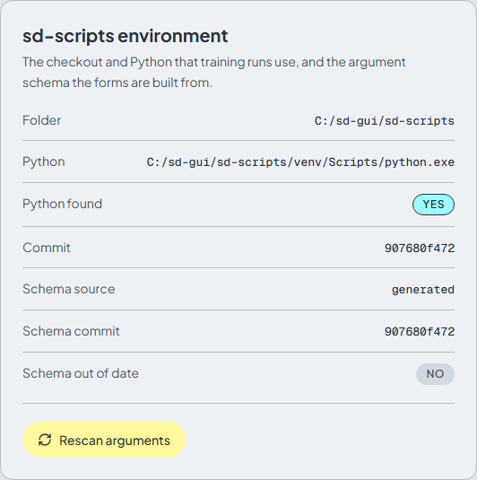

# Troubleshooting

[English](troubleshooting.md) | [ภาษาไทย](../th/troubleshooting.md)

## The job failed. Where do I find out why?

Open **Jobs**, select the failed job and read the end of the **Training log**: the last lines hold the Python error. The same lines are kept as the job's error. After fixing the cause, press **Retry** to run it again with the same settings.

## Nothing happens after Add to queue

The queue starts **paused**. Open **Jobs** and press **Start**. Each Start runs exactly one job: see [Jobs](jobs.md#the-queue).

## The "sd-scripts is not installed" banner



The sd-scripts Python environment was not found, so training cannot start. On Windows, run `install.bat` and reload the page. In the Docker image this should not happen: check the container log. **Settings > sd-scripts environment** shows the folder and Python the app looks for, and **Python found: No** confirms the problem. If you moved the install folder, run `install.bat` again from the new place.

## The argument schema is out of date

A banner says *The argument schema was generated from a different sd-scripts commit than the one installed.* This happens after you update sd-scripts. Open **Settings** and press **Rescan arguments**. It takes a short while, then the forms match the installed version. See [Settings](settings.md#sd-scripts-environment).

## CUDA is not available, or torch is a CPU build

`install.bat` stops with *the installed torch is not a CUDA build* when a package replaced the CUDA build of PyTorch with a CPU one. To fix it:

1. Update the NVIDIA driver to one that supports CUDA 12.8.
2. Delete the `sd-scripts\venv` folder and run `install.bat` again.
3. Check with `sd-scripts\venv\Scripts\python.exe -c "import torch; print(torch.__version__, torch.cuda.is_available())"`. You want a version with `+cu128` and `True`.

If your driver is too old for CUDA 12.8, set `TORCH_INDEX_URL` to another index before running `install.bat` (see [Install on Windows](install-windows.md)). If the **System resources** panel on **Jobs** says **GPU and VRAM unavailable**, the app cannot see an NVIDIA GPU either: check that `nvidia-smi` works in a terminal.

## Out of memory

The log ends with `CUDA out of memory` (or `OutOfMemoryError`). Try, in this order:

1. Turn on **Gradient checkpointing**, **Cache latents** and **Cache text encoder outputs**.
2. Lower the **Batch size** in the dataset config and the **Resolution**.
3. Lower **Network rank (dim)**.
4. For FLUX, SD3 and HunyuanImage, raise **Blocks to swap**, or turn on **FP8 base model**.
5. Close other programs that use the GPU. The **System resources** panel shows the VRAM in use.

See [Training: memory tips](training.md#memory-tips).

## Attempting to unscale FP16 gradients

The log ends with `ValueError: Attempting to unscale FP16 gradients`. It happens when **Mixed precision** is `fp16` and the network module keeps its trainable weights in fp16 (we saw it with `networks.dylora`). Set **Mixed precision** to `bf16`, which works on RTX 30xx and newer GPUs, and press **Retry**. The field is in the **Memory and speed** group. On older GPUs without bf16, use another network module (for example `networks.lora`) with fp16.

## Hugging Face error 401 or 403

A download fails for a [gated model](downloads.md#gated-models) (**FLUX.1 [dev]**, **Stable Diffusion 3.5**). Both steps are needed:

1. Accept the model's license on huggingface.co with the account that owns the token.
2. Put a token with read access in **Settings > Hugging Face token**, press **Save**, and start the download again.

Tokens are kept in memory only, so enter it again after restarting the app (or use the `HF_TOKEN` environment variable on the server).

## Port already in use

`run-browser.bat` uses port 8000. If another program has it, the server exits with an error. Pick another port first:

```bat
set SD_SCRIPTS_GUI_PORT=8100
run-browser.bat
```

The browser opens at the new address. The desktop window (`run.bat`) uses port 17860 and falls back to another free port when it is taken.

## The desktop window does not open (WebView2)

`run.bat` needs Microsoft WebView2, which is preinstalled on Windows 11. On Windows 10, install the [WebView2 Runtime](https://developer.microsoft.com/microsoft-edge/webview2/), or use `run-browser.bat`, which opens the app in your normal browser.

## Windows long paths or a non-ASCII install path

Python packages and PyTorch have deep folder trees. A long install path or a path with spaces, Thai or other non-ASCII characters can make `install.bat` or training fail with odd file errors. Install in a short ASCII path such as `C:\sd-gui`. If you must keep a long path, enable Windows long paths (the `LongPathsEnabled` policy) and restart.

## The run differs from the command preview (accelerate config)

sd-scripts starts through `accelerate`. If you ever ran `accelerate config` on the machine, its `default_config.yaml` is merged into **every** launch, and it can change things (mixed precision, number of processes, dynamo) that the **Command preview** does not show. If a run behaves differently from what you set, delete that file and start the job again:

| Where | File |
|---|---|
| Windows | `%USERPROFILE%\.cache\huggingface\accelerate\default_config.yaml` |
| Docker image | `/workspace/.cache/huggingface/accelerate/default_config.yaml` |

The app passes its own options (see **Accelerate** in [Settings](settings.md#accelerate)) on the command line, so you never need that file.

## A linked dataset folder is not in the folder picker

Folders under `workspace\datasets` that are links or junctions pointing outside the workspace are not listed in the **Image folders** tab or in the **Pick one of your image folders** list. Type the full path of the target folder into the **Image folder** field of the subset instead. Reading images from outside the workspace is allowed: only write paths are confined.

## A name or a path is rejected

The **Output name**, the **Log prefix** and the names of image folders are used in file names, so they have to be valid on Windows:

- They cannot contain `< > : " / \ | ? *` or `..`.
- They cannot start or end with a space, or end with a dot.
- They cannot be a reserved Windows name such as `CON`, `NUL` or `COM1`.

Thai (and other non-ASCII) names are fine.

Arguments that write files must point **inside the workspace**, and not inside the app's own data folder (`backend\data`). This applies to arguments that end in `_dir`, `_file` or `_path`, for example the console log file, the tokenizer cache folder and the DeepSpeed offload paths. Use a folder such as `outputs` or `logs`.

## Where files live

| What | Windows | Docker image |
|---|---|---|
| Downloaded models | `workspace\models` | `/workspace/models` |
| Image folders | `workspace\datasets` | `/workspace/datasets` |
| Trained LoRA and checkpoints | `workspace\outputs` | `/workspace/outputs` |
| Logs (TensorBoard) | `workspace\logs` | `/workspace/logs` |
| Job history, dataset configs, job logs | `backend\data` | `/workspace/.sd-scripts-gui` |
| sd-scripts and its environment | `sd-scripts\`, `sd-scripts\venv` | `/opt/sd-scripts`, `/opt/sd-venv` |
| Backend environment | `backend\.venv` | `/opt/app/backend/.venv` |

To reset the app without touching your files, close it and delete `backend\data`. You lose the job history and the dataset configs, not the models, images or outputs.

## Still stuck?

Ask on the [Facebook page](https://www.facebook.com/pixellatent), write to [vjumpkung@gmail.com](mailto:vjumpkung@gmail.com), or open a [GitHub issue](https://github.com/vjumpkung/vjump-sd-scripts-gui/issues). Include the end of the training log (the secrets are already removed from it) and the version shown in the sidebar.
