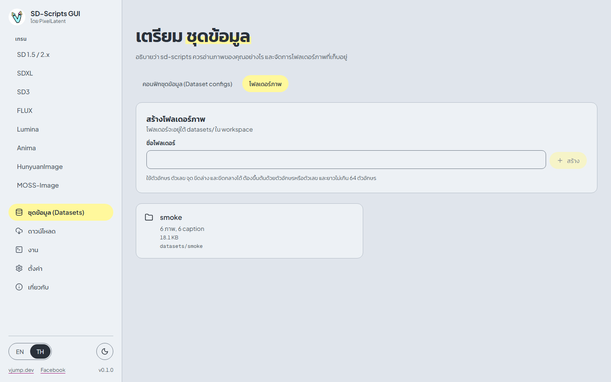
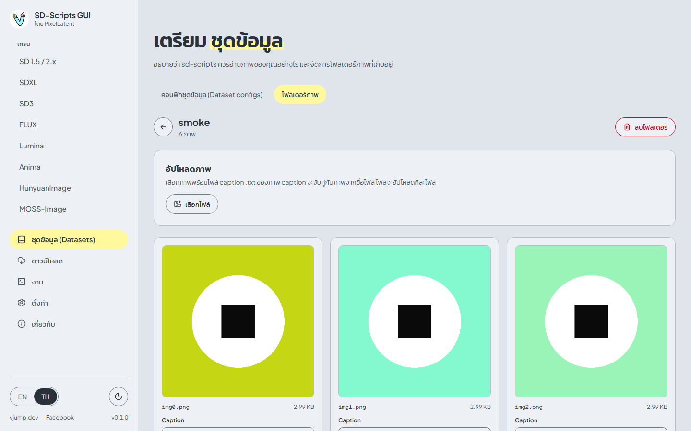
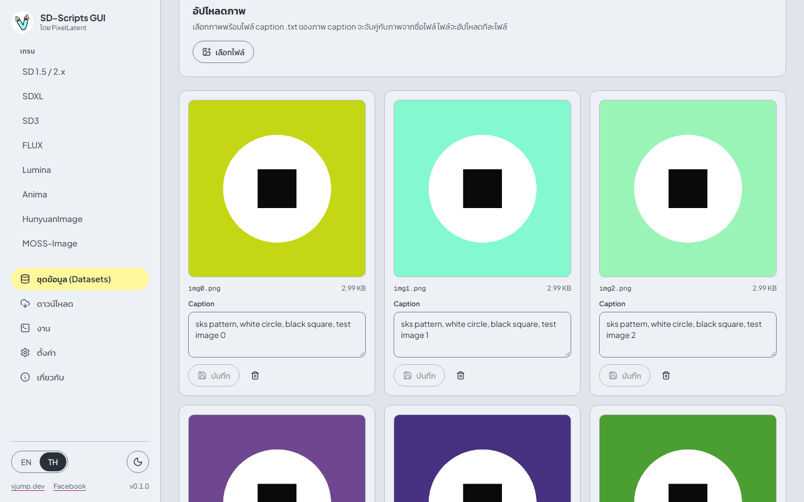
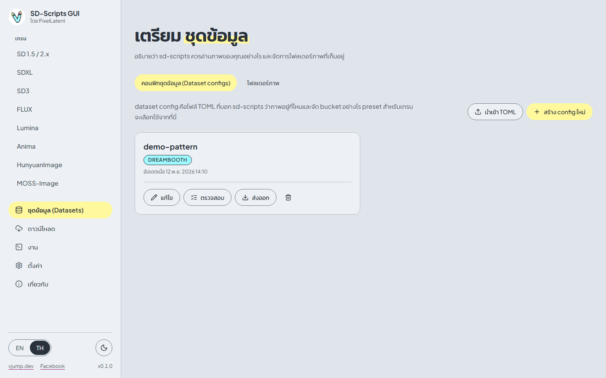
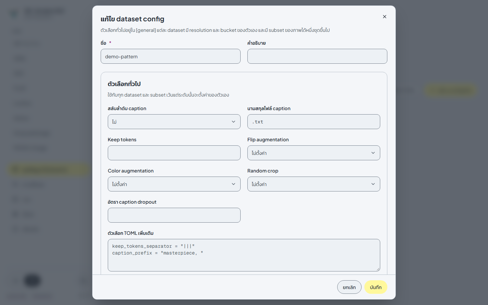
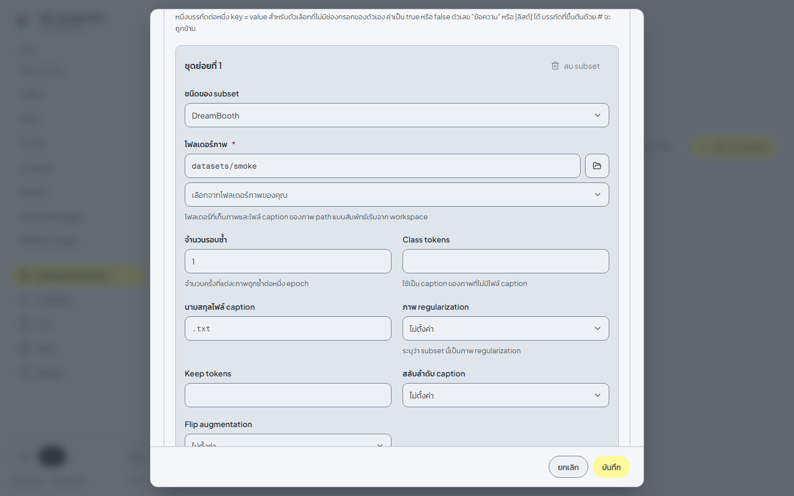
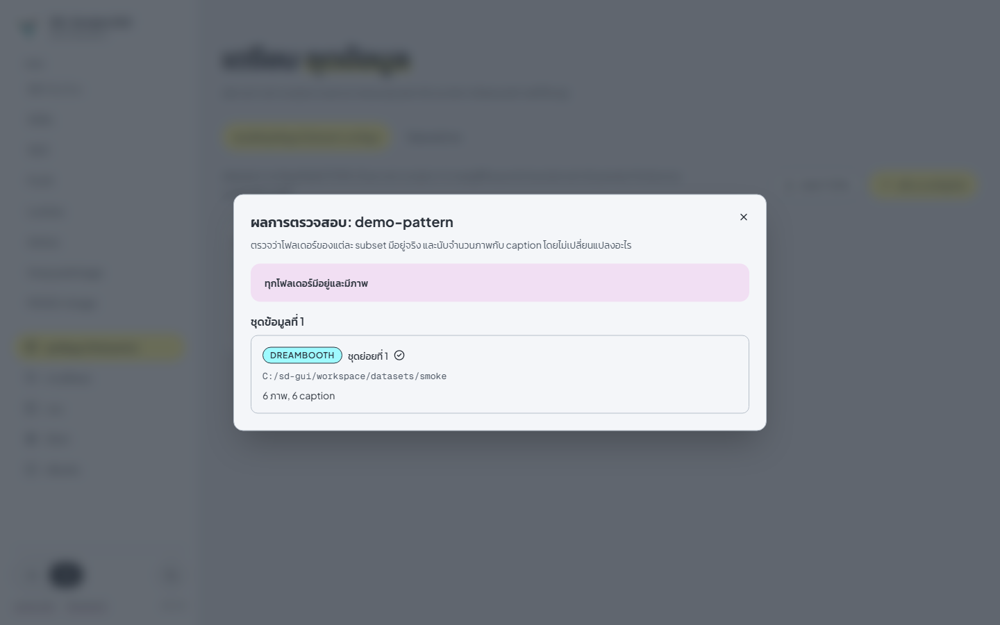

# ชุดข้อมูล (Datasets)

[English](../en/datasets.md) | [ภาษาไทย](datasets.md)

หน้า **ชุดข้อมูล (Datasets)** มีสองแท็บ **โฟลเดอร์ภาพ** เก็บภาพและ caption ส่วน **คอนฟิกชุดข้อมูล (Dataset configs)** เก็บไฟล์ TOML ที่บอก sd-scripts ว่าจะอ่านภาพเหล่านั้นอย่างไร preset สำหรับเทรนต้องใช้ dataset config (ยกเว้น LECO ที่เทรนจาก prompt อย่างเดียว)

## โฟลเดอร์ภาพ

โฟลเดอร์ภาพอยู่ใต้ `workspace/datasets/` ชื่อโฟลเดอร์ใช้ตัวอักษร ตัวเลข จุด ขีดล่าง และขีดกลาง ต้องขึ้นต้นด้วยตัวอักษรหรือตัวเลข และยาวไม่เกิน 64 ตัวอักษร

**สร้าง** โฟลเดอร์จากการ์ดด้านบนของแท็บ แล้วเปิดโฟลเดอร์เพื่อดูภาพข้างใน

### อัปโหลด

1. กด **เลือกไฟล์** หรือลากไฟล์มาวางบนการ์ดอัปโหลด
2. เลือกภาพ (`.png`, `.jpg`, `.jpeg`, `.webp`, `.bmp`) พร้อมไฟล์ caption
3. กด **อัปโหลด N ภาพ**

กติกา

- caption คือไฟล์ `.txt` แบบ **sidecar** ที่ชื่อเดียวกับภาพ: `cat01.png` + `cat01.txt` เบราว์เซอร์จะอ่านไฟล์ `.txt` แล้วส่ง caption ไปพร้อมกับภาพ
- ไฟล์ caption ที่ไม่มีภาพคู่กัน และไฟล์ชนิดอื่นจะถูกข้าม หน้านี้จะบอกจำนวนที่ข้าม
- ไฟล์อัปโหลด**ทีละไฟล์** เพื่อให้แต่ละ request มีขนาดเล็กพอสำหรับ proxy ของ cloud ระหว่างอัปโหลดจะออกจากหน้านี้ไม่ได้ กด **ยกเลิกการอัปโหลด** เพื่อหยุด
- ถ้าอัปโหลดไฟล์ชื่อซ้ำ ไฟล์เดิมจะถูกเขียนทับ ขีดจำกัดต่อไฟล์คือ 2 GiB (ค่าเริ่มต้น)
- การลบภาพจะลบไฟล์ `.txt` ของภาพนั้นด้วย การลบโฟลเดอร์จะลบทุกอย่างข้างใน และจะถูกปฏิเสธถ้ามีงานในคิวหรืองานที่กำลังทำงานใช้โฟลเดอร์นั้นอยู่

### แก้ caption

แต่ละ thumbnail มีกล่อง **Caption** พิมพ์ caption ใหม่แล้วกดปุ่มบันทึก ภาพที่ไม่มี caption จะแสดง **ไม่มี** หน้านี้แสดงทีละ 48 ภาพ กด **แสดงเพิ่มอีก N** เพื่อดูที่เหลือ

## คอนฟิกชุดข้อมูล (Dataset configs)

dataset config คือไฟล์ TOML ของ dataset ใน sd-scripts: ส่วน `[general]` หนึ่งส่วน `[[datasets]]` หนึ่งรายการขึ้นไป และ `[[datasets.subsets]]` ภายในแต่ละ dataset

| ปุ่ม | การทำงาน |
|---|---|
| **สร้าง config ใหม่** | เปิดตัวแก้ไขด้วย config ว่าง |
| **นำเข้า TOML** | สร้าง config จากไฟล์ `.toml` (ไม่เกิน 1 MB) ไฟล์ที่ไม่ถูกต้องจะถูกปฏิเสธพร้อมเหตุผล |
| **แก้ไข** | แก้ไข config |
| **ตรวจสอบ** | ตรวจโฟลเดอร์โดยไม่เปลี่ยนแปลงอะไร (ดูด้านล่าง) |
| **ส่งออก** | ดาวน์โหลด config เป็นไฟล์ `.toml` |
| ไอคอนถังขยะ | ลบ config งานที่เคยใช้ config นี้แล้วจะยังเก็บสำเนาของตัวเองไว้ |

### ตัวแก้ไข

| ระดับ | ควบคุมอะไร |
|---|---|
| **ตัวเลือกทั่วไป** | ใช้กับทุก dataset และ subset เว้นแต่ระดับนั้นจะตั้งค่าของตัวเอง: **สลับลำดับ caption**, **นามสกุลไฟล์ caption** (config ใหม่เริ่มที่ `.txt`), **Keep tokens**, **Flip augmentation**, **Color augmentation**, **Random crop**, **อัตรา caption dropout** |
| **ชุดข้อมูลที่ N** | **Resolution (กว้าง × สูง)**, **Batch size**, **เปิดใช้ bucket**, **Bucket no upscale**, **ความละเอียด bucket ต่ำสุด**, **ความละเอียด bucket สูงสุด**, **ช่วงห่างของความละเอียด bucket** |
| **ชุดย่อยที่ N** | แหล่งภาพหนึ่งชุด: โฟลเดอร์ของมัน, **จำนวนรอบซ้ำ** และตัวเลือกที่ override ระดับด้านบน |

ตัวเลือกที่ตั้งเป็น **ไม่ตั้งค่า** จะไม่ใส่ key นั้นลงใน TOML ทำให้ใช้ค่าเริ่มต้นของ sd-scripts (หรือค่าของระดับบน) กด **เพิ่ม dataset** หรือ **เพิ่ม subset** เมื่อต้องการมากกว่าหนึ่งชุด config หนึ่งอันมีได้หลาย dataset และหนึ่ง dataset มีได้หลาย subset

### ชนิดของ subset

เลือก **ชนิดของ subset** ซึ่งกำหนดว่าจะมีช่องกรอกอะไรบ้าง และ preset ไหนยอมรับ config นี้

| ชนิด | ช่องกรอก | ใช้กับ |
|---|---|---|
| **DreamBooth** | **โฟลเดอร์ภาพ**, **จำนวนรอบซ้ำ**, **Class tokens**, **นามสกุลไฟล์ caption**, **ภาพ regularization** | ส่วนใหญ่ของ preset และเป็นชนิดเดียวที่ preset DreamBooth ยอมรับ |
| **Fine-tune (ไฟล์ metadata)** | **ไฟล์ metadata** (ไฟล์ JSON ที่เก็บ caption), **โฟลเดอร์ภาพ (ไม่บังคับ)**, **จำนวนรอบซ้ำ** | preset Fine-tune และ LoRA ส่วนใหญ่ preset SD 1.5 Fine-tune ยอมรับเฉพาะชนิดนี้ |
| **ControlNet** | **โฟลเดอร์ภาพ**, **โฟลเดอร์ภาพ conditioning** (ภาพควบคุมที่จับคู่กับภาพที่ใช้เทรน), **จำนวนรอบซ้ำ** | preset ControlNet และ ControlNet-LLLite ซึ่งยอมรับเฉพาะชนิดนี้ |

ชนิดไม่ได้ถูกเก็บเป็นค่าโดยตรง sd-scripts อนุมานจาก key ที่มี (มี `metadata_file` จะเป็น fine-tune, มี `conditioning_data_dir` จะเป็น ControlNet) อย่าผสม subset แบบ DreamBooth กับ fine-tune ใน dataset เดียวกัน คอลัมน์ **ชนิด dataset** ใน[ตาราง preset](training.md#preset-ของแต่ละตระกูล)บอกว่าแต่ละ preset ยอมรับอะไร หน้าเทรนก็แสดงข้อมูลเดียวกันข้างช่อง **คอนฟิกชุดข้อมูล (Dataset config)** และจะแสดงเฉพาะ config ที่ใช้ได้

path เป็นแบบสัมพัทธ์กับ workspace (`datasets/cat`) หรือแบบเต็มก็ได้ ใช้ **เลือกจากโฟลเดอร์ภาพของคุณ** เพื่อเติมโฟลเดอร์จากรายการ

### Caption

**นามสกุลไฟล์ caption** คือนามสกุลของไฟล์ caption โฟลเดอร์ภาพเก็บ caption เป็น `.txt` จึงควรใช้ `.txt` ค่าเริ่มต้นของ sd-scripts เองคือ `.caption` ถ้า config ไม่มี key นี้ caption ของคุณจะถูกมองข้าม

**Class tokens** ใช้เป็น caption ของภาพที่ไม่มีไฟล์ caption

### ตัวเลือก TOML เพิ่มเติม

key ที่ไม่มีช่องกรอกของตัวเองให้ใส่ใน **ตัวเลือก TOML เพิ่มเติม** หนึ่งบรรทัดต่อหนึ่ง `key = value` ค่าเป็น `true` หรือ `false` ตัวเลข `"ข้อความ"` หรือ `[ลิสต์]` ได้ บรรทัดที่ขึ้นต้นด้วย `#` จะถูกข้าม key ที่ backend ไม่รู้จักจะถูกบันทึกไว้ และแสดงเป็น **คำเตือนจาก backend** แทนที่จะขัดขวางการบันทึก

### ตรวจสอบ

**ตรวจสอบ** เปิดรายงานที่บอกของแต่ละ subset ว่าโฟลเดอร์มีอยู่หรือไม่ มีภาพและ caption กี่ไฟล์ และภาพแรก ๆ ที่ไม่มี caption

ผลผ่านเมื่อทุกโฟลเดอร์มีอยู่และมีภาพอย่างน้อยหนึ่งภาพ caption นับด้วยนามสกุล caption ที่มีผลจริงของ subset นั้น

## ถัดไป

นำ config ไปใช้ที่หน้า[การเทรน](training.md)
