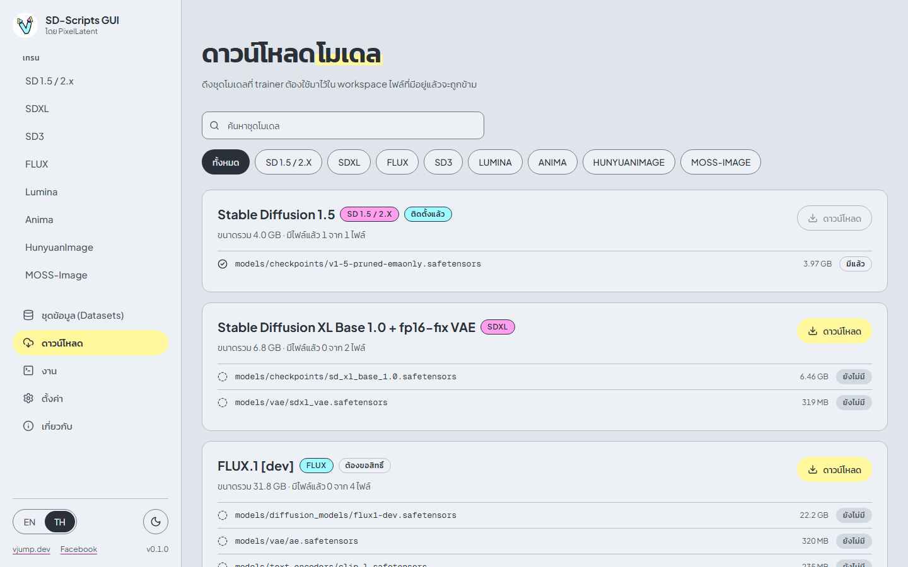

# ดาวน์โหลด

[English](../en/downloads.md) | [ภาษาไทย](downloads.md)

หน้า **ดาวน์โหลด** ดึงไฟล์โมเดลที่ trainer ต้องใช้จาก Hugging Face เข้า workspace ของคุณโดยตรง มีรายการชุดโมเดลที่ตรวจสอบแล้วแบบตายตัว ไม่รับ URL อื่น

## รายการชุดโมเดล

แต่ละการ์ดคือหนึ่งชุด: ชื่อ ป้ายตระกูล ขนาดรวม และรายการไฟล์ พร้อมสถานะ **มีแล้ว** หรือ **ยังไม่มี** ข้างไฟล์ ชุดที่มีครบทุกไฟล์จะขึ้น **ติดตั้งแล้ว**

| ID | ชื่อ | ตระกูล | ขนาด | จำนวนไฟล์ | ต้องขอสิทธิ์ |
|---|---|---|---|---|---|
| `sd15` | Stable Diffusion 1.5 | SD 1.5 / 2.x | 4.0 GB | 1 | ไม่ |
| `sdxl-base` | Stable Diffusion XL Base 1.0 + fp16-fix VAE | SDXL | 6.8 GB | 2 | ไม่ |
| `flux1-dev` | FLUX.1 [dev] | FLUX | 31.8 GB | 4 | ใช่ |
| `flux-text-encoders-fp8` | FLUX T5-XXL fp8 (low VRAM, optional) | FLUX | 4.6 GB | 1 | ไม่ |
| `chroma1-base` | Chroma1-Base | FLUX | 26.0 GB | 3 | ไม่ |
| `sd35-large` | Stable Diffusion 3.5 Large | SD3 | 26.0 GB | 4 | ใช่ |
| `sd35-medium` | Stable Diffusion 3.5 Medium | SD3 | 15.4 GB | 4 | ใช่ |
| `lumina2` | Lumina Image 2.0 | Lumina | 10.0 GB | 3 | ไม่ |
| `anima` | Anima base v1.0 | Anima | 5.2 GB | 3 | ไม่ |
| `hunyuan-image-2.1` | HunyuanImage 2.1 | HunyuanImage | 49.1 GB | 4 | ไม่ |
| `moss-image` | MOSS-Image Base | MOSS-Image | 25.3 GB | 8 | ไม่ |

ขนาดคือยอดรวมที่แสดงบนการ์ด ใช้ **ค้นหาชุดโมเดล** หรือปุ่มตระกูลโมเดลเพื่อกรอง

## ดาวน์โหลดชุดโมเดล

1. กด **ดาวน์โหลด** บนการ์ด แถบความคืบหน้าจะแสดงไฟล์ที่กำลังโหลด
2. กด **ยกเลิก** เพื่อหยุด ไฟล์ที่โหลดเสร็จแล้วจะยังอยู่
3. เมื่อการ์ดขึ้นว่า **ติดตั้งแล้ว** โมเดลก็พร้อมให้ปุ่ม **ใช้ path ที่แนะนำ** ในหน้าเทรนใช้

รายละเอียด

- ไฟล์ไปอยู่ใน `workspace/models/...` ตามโฟลเดอร์ที่ preset คาดหวัง: `models/checkpoints`, `models/diffusion_models`, `models/text_encoders`, `models/vae` และสำหรับ MOSS-Image คือ `models/moss_image`
- **ไฟล์ที่มีอยู่แล้วและขนาดตรงกับที่คาดไว้จะถูกข้าม** หลายชุดใช้ไฟล์ร่วมกัน (เช่น `models/vae/ae.safetensors` และ text encoder T5-XXL) ชุดที่สองจึงมักโหลดน้อยกว่าขนาดรวมของมัน
- การดาวน์โหลดสองงานที่จะเขียนไฟล์เดียวกันพร้อมกันจะถูกปฏิเสธ
- รายการดาวน์โหลดอยู่ในแอปที่กำลังรันเท่านั้น ถ้าปิดแอปกลางคัน ให้กด **ดาวน์โหลด** ใหม่ ไฟล์ที่เสร็จแล้วจะถูกข้าม
- ชุดโมเดลมีขนาดใหญ่ ตรวจพื้นที่ดิสก์ว่างก่อน

## โมเดลที่ต้องขอสิทธิ์

**FLUX.1 [dev]**, **Stable Diffusion 3.5 Large** และ **Stable Diffusion 3.5 Medium** เป็นแบบ **ต้องขอสิทธิ์**: Hugging Face ให้ไฟล์เฉพาะบัญชีที่ยอมรับ license ของโมเดลแล้ว ต้องทำสองอย่าง

1. **ยอมรับ license** ล็อกอินที่ [huggingface.co](https://huggingface.co) เปิดหน้าโมเดล ([FLUX.1-dev](https://huggingface.co/black-forest-labs/FLUX.1-dev), [SD 3.5 Large](https://huggingface.co/stabilityai/stable-diffusion-3.5-large), [SD 3.5 Medium](https://huggingface.co/stabilityai/stable-diffusion-3.5-medium)) แล้วยอมรับเงื่อนไข
2. **ใส่ token** สร้าง access token สิทธิ์ read ที่ [huggingface.co/settings/tokens](https://huggingface.co/settings/tokens) ในแอปเปิดหน้า **ตั้งค่า** วางที่ช่อง **Hugging Face token** แล้วกด **บันทึก** การ์ดของโมเดลที่ต้องขอสิทธิ์ก็มีลิงก์ไปที่นั่น (**ใส่ token ในหน้าตั้งค่า**)

ถ้าไม่ครบทั้งสองอย่าง การดาวน์โหลดจะล้มเหลวด้วย HTTP 401 หรือ 403 ดู[แก้ปัญหา](troubleshooting.md) token ถูกเก็บในหน่วยความจำของแอปเท่านั้นและไม่เคยถูกเขียนลงดิสก์ (ดู[ตั้งค่า](settings.md)) token เดียวกันนี้ถูกส่งให้การเทรนเป็น `HF_TOKEN` ด้วย

ชุดโมเดลอื่นไม่ต้องขอสิทธิ์และไม่ต้องใช้ token

## ใช้โมเดลของคุณเอง

รายการนี้เป็นแค่ความสะดวก ไฟล์โมเดลใด ๆ ที่วางใน workspace ก็ใช้ได้ คัดลอกไปไว้ใน `workspace/models/` แล้วเลือกด้วยปุ่ม **เลือกไฟล์** ในส่วน **ไฟล์โมเดล** ในแอปเดสก์ท็อปเลือกไฟล์จากที่ไหนในดิสก์ก็ได้
