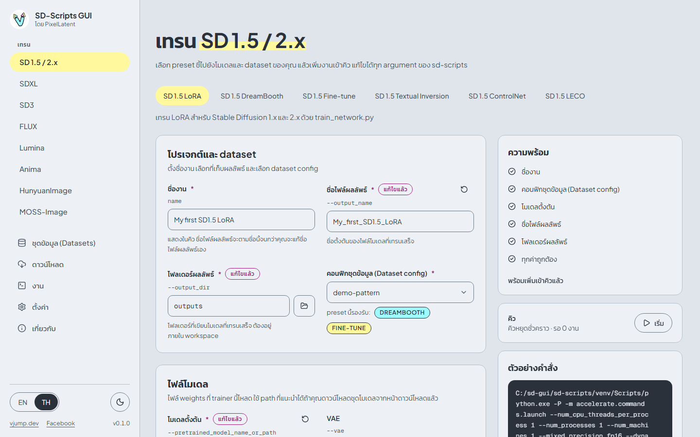
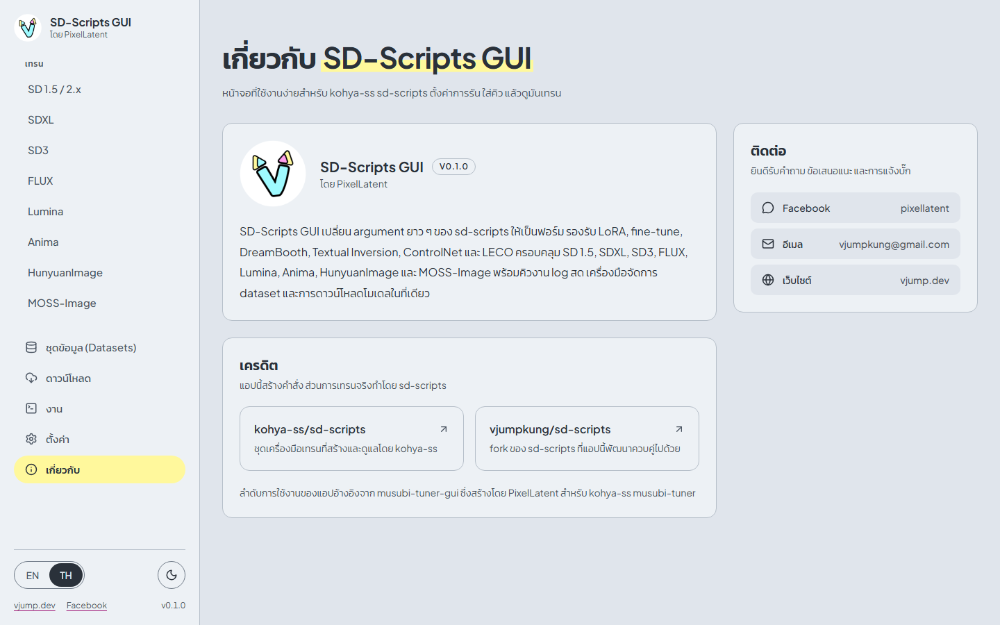
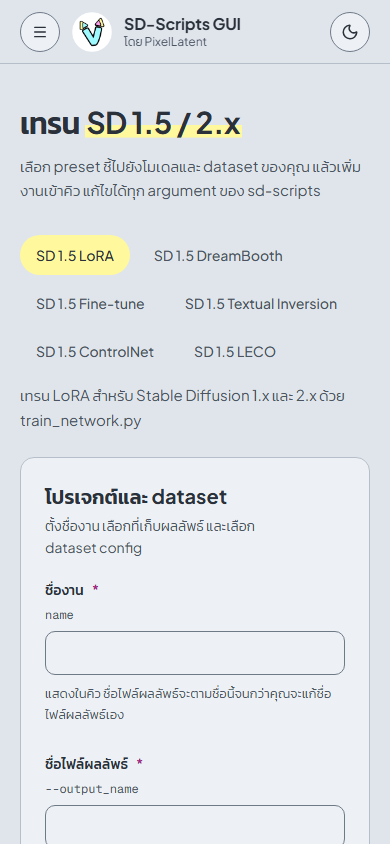

# เอกสาร SD-Scripts GUI

[English](../en/index.md) | [ภาษาไทย](index.md)

SD-Scripts GUI คือหน้าจอแบบเว็บและเดสก์ท็อปสำหรับ [kohya-ss sd-scripts](https://github.com/kohya-ss/sd-scripts) ช่วยแปลง argument ยาว ๆ ของสคริปต์เทรน 24 ตัวของ sd-scripts ให้เป็นฟอร์ม จัดคิวงาน และแสดง log กับผลลัพธ์แบบสด ส่วนการเทรนจริงทำโดย sd-scripts

## แผนที่เอกสาร

| หน้า | เนื้อหา |
|---|---|
| [ติดตั้งบน Windows](install-windows.md) | ความต้องการของระบบ, `install.bat`, `run.bat`, `run-browser.bat`, การอัปเดต, การถอนการติดตั้ง |
| [Cloud: Runpod และ Vast.ai](cloud-runpod-vast.md) | Docker image, port, environment variable, รหัสผ่าน, JupyterLab |
| [เริ่มต้นใช้งาน](quick-start.md) | เทรน LoRA ตัวแรกตั้งแต่ต้นจนจบ พร้อมภาพหน้าจอ |
| [ชุดข้อมูล (Datasets)](datasets.md) | โฟลเดอร์ภาพ, caption, dataset config (TOML) |
| [การเทรน](training.md) | Preset, ไฟล์โมเดล, พารามิเตอร์, ตัวอย่างคำสั่ง, เคล็ดลับประหยัดหน่วยความจำ |
| [งาน](jobs.md) | คิว, log, ความคืบหน้า, ไฟล์ผลลัพธ์, ยกเลิกและลองใหม่ |
| [ดาวน์โหลด](downloads.md) | รายการชุดโมเดลและโมเดลที่ต้องขอสิทธิ์ |
| [ตั้งค่า](settings.md) | ข้อมูลลับ, Accelerate, environment ของ sd-scripts, ภาษาและธีม |
| [แก้ปัญหา](troubleshooting.md) | ข้อผิดพลาดที่พบบ่อยและตำแหน่งของไฟล์ |

## โครงสร้างของแอป

แถบด้านข้าง (sidebar) มีรายการของแต่ละตระกูลโมเดลใต้หัวข้อ **เทรน** ตามด้วยหน้าอื่นอีกห้าหน้า

| รายการใน sidebar | หน้าที่ |
|---|---|
| **เทรน** > SD 1.5 / 2.x, SDXL, SD3, FLUX, Lumina, Anima, HunyuanImage, MOSS-Image | หนึ่งหน้าต่อหนึ่งตระกูลโมเดล แต่ละหน้ามีแท็บของ preset (LoRA, Fine-tune, DreamBooth, ...) |
| **ชุดข้อมูล (Datasets)** | สองแท็บ: **คอนฟิกชุดข้อมูล (Dataset configs)** (ไฟล์ TOML ที่บอก sd-scripts ว่าภาพอยู่ที่ไหน) และ **โฟลเดอร์ภาพ** (อัปโหลดภาพและ caption) |
| **ดาวน์โหลด** | ดึงชุดโมเดลมาไว้ใน workspace ในคลิกเดียว |
| **งาน** | คิว, log สด, ความคืบหน้า, ไฟล์ผลลัพธ์ และตัวติดตามทรัพยากรของเครื่อง |
| **ตั้งค่า** | ข้อมูลลับของ Hugging Face และ W&B, ตัวเลือก Accelerate, environment ของ sd-scripts, ภาษา, ธีม |
| **เกี่ยวกับ** | เวอร์ชัน, เครดิต, ช่องทางติดต่อ |

ลำดับการใช้งานทั่วไปคือ **ดาวน์โหลด** (เอาโมเดล) → **ชุดข้อมูล (Datasets)** (ภาพและ dataset config) → **เทรน** (กรอกฟอร์ม แล้วกด **เพิ่มเข้าคิว**) → **งาน** (กด **เริ่ม** ดูความคืบหน้า แล้วดาวน์โหลดผลลัพธ์)

หน้า **เกี่ยวกับ** แสดงเวอร์ชัน เครดิต และช่องทางติดต่อผู้พัฒนา

## บนหน้าจอแคบ

บนโทรศัพท์หรือหน้าต่างที่แคบ sidebar จะย้ายไปอยู่หลังปุ่มเมนู และคอลัมน์ของหน้าเทรนจะเรียงต่อกันในแนวตั้ง สะดวกเมื่อรันแอปบน cloud

## ไฟล์อยู่ที่ไหน

โมเดล dataset ผลลัพธ์ และ log ทั้งหมดอยู่ในโฟลเดอร์เดียวที่เรียกว่า **workspace** แอปจะไม่เขียนไฟล์นอกโฟลเดอร์นี้

| โฟลเดอร์ | เนื้อหา |
|---|---|
| `workspace/models/` | ไฟล์โมเดลที่ดาวน์โหลด |
| `workspace/datasets/` | โฟลเดอร์ภาพ |
| `workspace/outputs/` | ไฟล์ LoRA และ checkpoint ที่เทรนเสร็จ |
| `workspace/logs/` | ที่เก็บ log ของ TensorBoard (พิมพ์ `logs` ในช่อง **โฟลเดอร์ log**) |
| `backend/data/` | ประวัติงานและ dataset config (ฐานข้อมูล SQLite) กับโฟลเดอร์ของแต่ละงานที่มี log ใน Docker image อยู่ที่ `/workspace/.sd-scripts-gui` |

workspace คือ `<โฟลเดอร์ที่ติดตั้ง>\workspace` บน Windows และ `/workspace` ใน Docker image

## ภาษา

หน้าจอรองรับภาษาอังกฤษและไทย สลับได้ด้วยปุ่ม **EN | TH** ที่ท้าย sidebar หรือในหน้า **ตั้งค่า** เอกสารนี้มีทั้งสองภาษา และภาพหน้าจอจะตรงกับภาษาของเอกสาร

## ติดต่อ

ยินดีรับคำถาม ข้อเสนอแนะ และการแจ้งบั๊ก: [เพจ Facebook](https://www.facebook.com/pixellatent), [vjumpkung@gmail.com](mailto:vjumpkung@gmail.com), [vjump.dev](https://vjump.dev) หรือ [GitHub issues](https://github.com/vjumpkung/vjump-sd-scripts-gui/issues)
