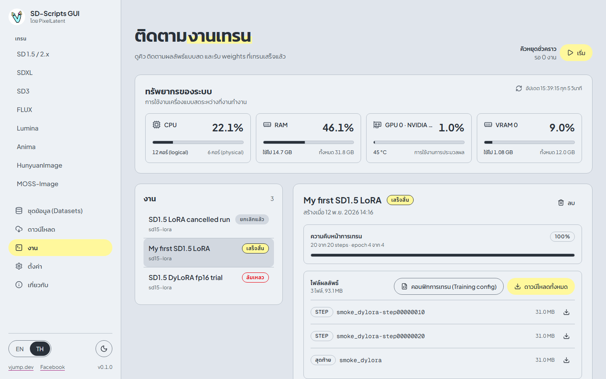
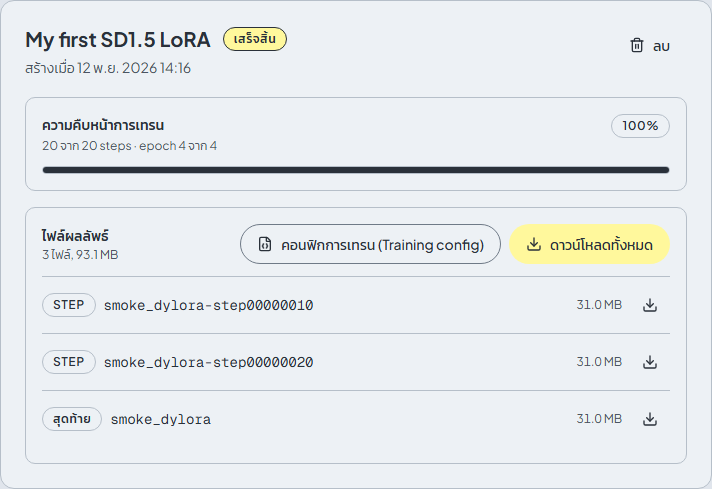
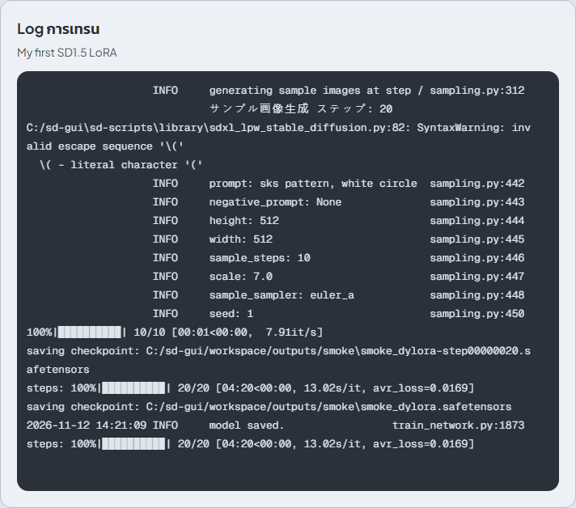

# งาน

[English](../en/jobs.md) | [ภาษาไทย](jobs.md)

หน้า **งาน** แสดงคิว log สดของงานที่เลือก ความคืบหน้า ไฟล์ผลลัพธ์ และตัวติดตาม CPU, RAM และ GPU ของเครื่อง

## คิว

ปุ่ม **เพิ่มเข้าคิว** ในหน้าเทรนจะสร้างงานในสถานะ **รอคิว** งานจะรันทีละหนึ่งงานตามลำดับตำแหน่งในคิว

คิวเริ่มต้นใน**สถานะหยุดชั่วคราว** การเพิ่มงานจึงไม่เริ่มเทรนเอง ปุ่ม **เริ่ม** (ในหน้านี้ และในการ์ด **คิว** ของทุกหน้าเทรน) ใช้เริ่มคิว **เริ่มจะรันเพียงหนึ่งงาน** เมื่อมันจบ ไม่ว่าจะสำเร็จ ล้มเหลว หรือถูกยกเลิก คิวจะหยุดชั่วคราวอีกครั้ง ถ้าจะรันงานถัดไปในคิวให้กด **เริ่ม** อีกครั้ง เป็นการออกแบบไว้อย่างนี้เพื่อให้คุณดูผลของแต่ละรอบก่อนที่รอบถัดไปจะใช้ GPU

- **หยุดชั่วคราว** แค่กันไม่ให้คิวเริ่มงานถัดไป ไม่ได้หยุดงานที่กำลังรันอยู่ ถ้าจะหยุดงานให้ใช้ **ยกเลิก**
- งานในคิวแสดง **คิวที่ N** ปุ่มลูกศรขึ้นลง (**ย้ายขึ้นในคิว**, **ย้ายลงในคิว**) ใช้เปลี่ยนลำดับ
- ถ้าปิดแอปหรือแอปรีสตาร์ทขณะงานกำลังรัน งานนั้นจะเป็น **ล้มเหลว** พร้อมข้อความ `Interrupted by server restart`

| สถานะ | ความหมาย |
|---|---|
| **รอคิว** | รอถึงตาของตัวเอง |
| **กำลังทำงาน** | กำลังเทรน |
| **เสร็จสิ้น** | จบโดยไม่มีข้อผิดพลาด |
| **ล้มเหลว** | สคริปต์หยุดด้วยข้อผิดพลาด log 20 บรรทัดสุดท้ายจะถูกเก็บเป็นข้อความ error |
| **ยกเลิกแล้ว** | คุณเป็นคนหยุด |

## เลือกงาน

คลิกงานในรายการ ฝั่งขวาจะแสดงชื่อ เวลาที่สร้าง ปุ่มต่าง ๆ ความคืบหน้า ไฟล์ผลลัพธ์ และ log อยู่ด้านล่าง

| ปุ่ม | ใช้ได้กับ | ผลลัพธ์ |
|---|---|---|
| **ยกเลิก** | งานที่รอคิวและงานที่กำลังรัน | หยุดงาน process tree ของการเทรนทั้งหมดจะถูกปิด รวมถึง process ลูกที่ sd-scripts เปิดขึ้น จะมีหน้าต่างยืนยันก่อน |
| **ลองอีกครั้ง** | งานที่ล้มเหลวและงานที่ยกเลิกแล้ว | สร้างงานใหม่ในคิวด้วยค่าและสำเนา dataset เดิม |
| **ลบ** | งานที่จบแล้ว | ลบงานและ log ของมัน weights ที่บันทึกไว้ในโฟลเดอร์ผลลัพธ์จะไม่ถูกลบ |

แต่ละงานเก็บสำเนา TOML ของ dataset ไว้เอง การแก้หรือลบ dataset config ภายหลังจึงไม่กระทบงานที่สร้างไปแล้ว และ **ลองอีกครั้ง** จะใช้สำเนาเดิม

## ความคืบหน้า

แถบความคืบหน้าแสดง **N จาก M steps** และ **epoch X จาก Y** อ่านจาก log: ตัวนับ step ของ sd-scripts (บรรทัดที่ขึ้นต้นด้วย `steps:`) และบรรทัด `epoch X/Y` ก่อนถึง training step แรกจะแสดง **รอ training step แรก** ขั้นตอนอย่าง caching latents ก่อนหน้านั้นไม่ถูกนับ

## Log การเทรน

**Log การเทรน** คือผลลัพธ์สดของสคริปต์ แสดงในมุมมองแบบ terminal มีสีและ progress bar เลื่อนและเลือกข้อความได้ งานที่จบแล้วยังเก็บ log ไว้จนกว่าคุณจะลบงาน เมื่องานล้มเหลว ท้าย log จะมีสาเหตุ ดู[แก้ปัญหา](troubleshooting.md)

ข้อมูลลับอย่าง Hugging Face token จะถูกตัดออกจาก log

## ไฟล์ผลลัพธ์

การ์ด **ไฟล์ผลลัพธ์** แสดงไฟล์ที่เขียนลงโฟลเดอร์ผลลัพธ์ของงาน

| ชนิด | ชื่อไฟล์ | คืออะไร |
|---|---|---|
| **สุดท้าย** | `<ชื่อไฟล์ผลลัพธ์>.safetensors` | โมเดลที่เทรนเสร็จ |
| **epoch** | `<ชื่อไฟล์ผลลัพธ์>-000005.safetensors` | checkpoint ที่บันทึกตอนจบ epoch |
| **step** | `<ชื่อไฟล์ผลลัพธ์>-step00000100.safetensors` | checkpoint ที่บันทึกทุก N steps |

- ไอคอนดาวน์โหลดที่แถวใช้ดาวน์โหลดไฟล์นั้น
- **ดาวน์โหลดทั้งหมด** ดาวน์โหลดทุกไฟล์ผลลัพธ์เป็นไฟล์ `.zip` เดียว
- **คอนฟิกการเทรน (Training config)** ดาวน์โหลดค่าของงานเป็นไฟล์ JSON โหลดกลับได้ด้วย **นำเข้า config** ในหน้าเทรน

ไฟล์จะปรากฏระหว่างที่งานรัน จึงดาวน์โหลด checkpoint ก่อนเทรนจบได้ ไฟล์อยู่บนดิสก์ใน `workspace/outputs/` ด้วย

## ทรัพยากรของระบบ

ตัวติดตามด้านบนแสดง CPU, RAM และของ GPU แต่ละใบ: การใช้งาน, VRAM และอุณหภูมิ อัปเดตทุก 5 วินาที ใช้ดูว่ารอบเทรนใกล้ขีดจำกัด VRAM แค่ไหน ถ้าไม่มีข้อมูล GPU ก็จะแจ้งไว้
