# เริ่มต้นใช้งาน: เทรน LoRA ตัวแรก

[English](../en/quick-start.md) | [ภาษาไทย](quick-start.md)

หน้านี้พาเทรน SD 1.5 LoRA หนึ่งตัวตั้งแต่ workspace ว่างเปล่าจนได้ไฟล์ที่เทรนเสร็จ สมมติว่าติดตั้งและเปิดแอปแล้ว ([Windows](install-windows.md) หรือ [cloud](cloud-runpod-vast.md)) ภาพหน้าจอใช้ dataset ตัวอย่างขนาดเล็ก 6 ภาพ

สิ่งที่ต้องมี: โฟลเดอร์ภาพ (สำหรับลองครั้งแรก 10 ถึง 30 ภาพก็พอ) และถ้าเป็นไปได้ให้แต่ละภาพมี caption ในไฟล์ `.txt` ชื่อเดียวกัน (`cat01.png` + `cat01.txt`)

## 1. ดาวน์โหลดโมเดล

เปิดหน้า **ดาวน์โหลด** แล้วกด **ดาวน์โหลด** ที่ **Stable Diffusion 1.5** (ประมาณ 4 GB) ความคืบหน้าจะแสดงบนการ์ด โมเดลจะไปอยู่ใน `workspace/models/` การ์ดที่ขึ้นว่า **ติดตั้งแล้ว** คือพร้อมใช้

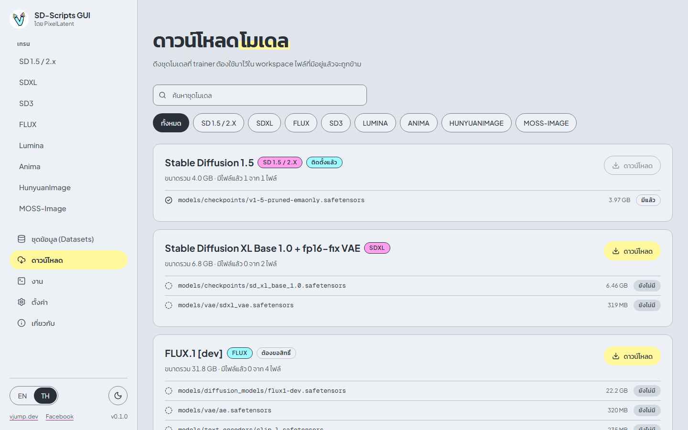

อ่านเรื่องชุดโมเดลและโมเดลที่ต้องขอสิทธิ์เพิ่มได้ที่[ดาวน์โหลด](downloads.md)

## 2. อัปโหลดภาพ

เปิด **ชุดข้อมูล (Datasets)** แล้วเลือกแท็บ **โฟลเดอร์ภาพ** สร้างโฟลเดอร์ (ใช้ตัวอักษร ตัวเลข จุด ขีดล่าง และขีดกลาง ยาวไม่เกิน 64 ตัวอักษร) แล้วเปิดเข้าไป

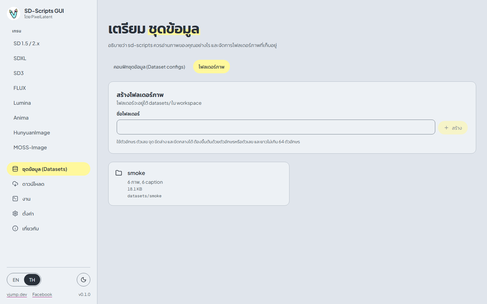

กด **เลือกไฟล์** แล้วเลือกภาพพร้อมไฟล์ caption `.txt` ของภาพ หน้านี้จะจับคู่ caption กับภาพจากชื่อไฟล์ และบอกจำนวนภาพ caption และไฟล์ที่ไม่มีคู่ที่พบ กด **อัปโหลด N ภาพ** ไฟล์จะอัปโหลดทีละไฟล์

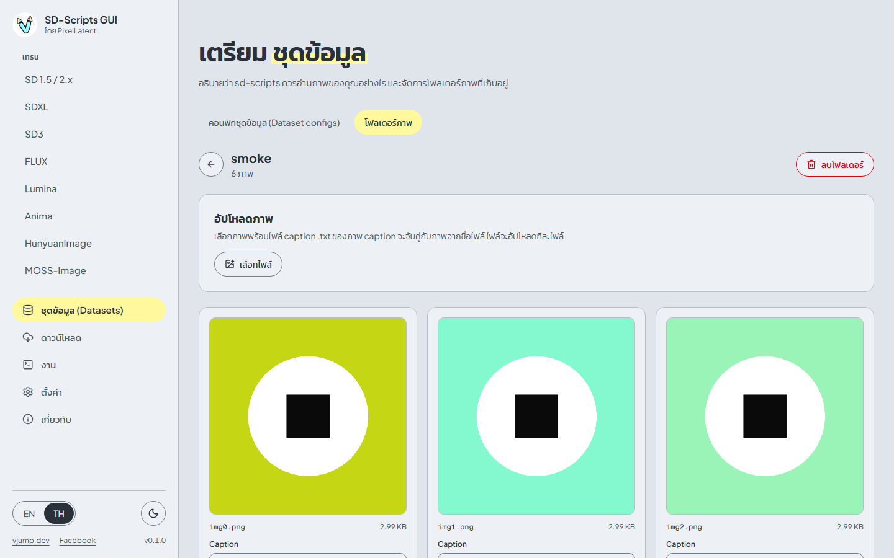

ใต้แต่ละภาพจะแสดง caption ของภาพ แก้ caption ตรงนั้นแล้วบันทึกได้เลย ดูรายละเอียดที่ [ชุดข้อมูล (Datasets)](datasets.md)

## 3. สร้าง dataset config

dataset config คือไฟล์ TOML ขนาดเล็กที่บอก sd-scripts ว่าภาพอยู่ที่ไหนและจัด bucket อย่างไร เปิดแท็บ **คอนฟิกชุดข้อมูล (Dataset configs)** แล้วกด **สร้าง config ใหม่**

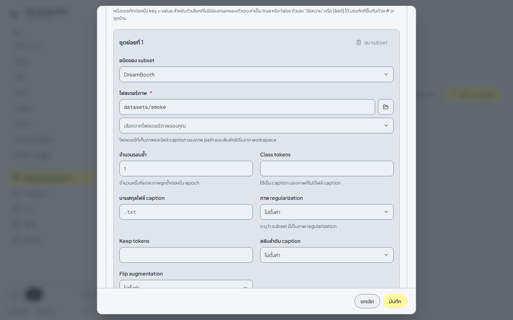

1. ตั้ง **ชื่อ**
2. ใน **ตัวเลือกทั่วไป** ช่อง **นามสกุลไฟล์ caption** เป็น `.txt` อยู่แล้ว ซึ่งตรงกับไฟล์ caption ที่อัปโหลด
3. ใน **ชุดข้อมูลที่ 1** ตั้ง **Resolution (กว้าง × สูง)** (512 × 512 สำหรับ SD 1.5)
4. ใน **ชุดย่อยที่ 1** เลือกโฟลเดอร์ภาพของคุณ และตั้ง **จำนวนรอบซ้ำ**
5. กด **บันทึก**

กด **ตรวจสอบ** บนการ์ดเพื่อเช็กว่าโฟลเดอร์มีอยู่จริง และนับจำนวนภาพกับ caption

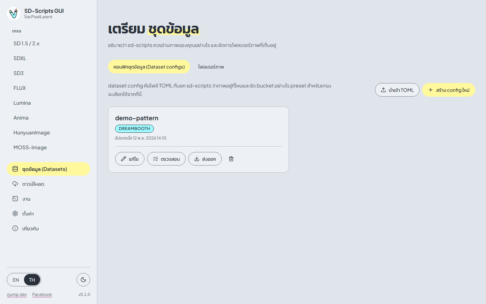

## 4. กรอกฟอร์มเทรน

เปิด **เทรน > SD 1.5 / 2.x** แล้วใช้แท็บ **SD 1.5 LoRA** ตามเดิม

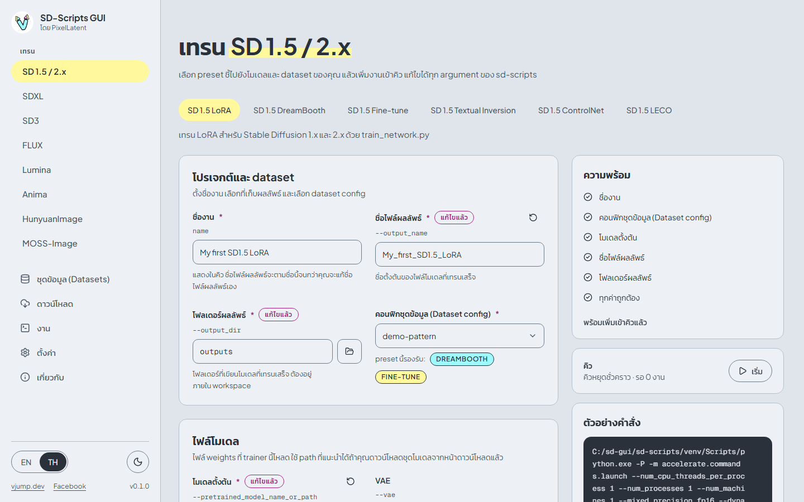

1. **ชื่องาน**: ตั้งชื่ออะไรก็ได้ ชื่อไฟล์ผลลัพธ์จะตามชื่อนี้
2. **คอนฟิกชุดข้อมูล (Dataset config)**: เลือก config จากขั้นตอนที่ 3
3. **ไฟล์โมเดล > โมเดลตั้งต้น**: กด **ใช้ path ที่แนะนำ** ป้ายจะขึ้นว่า **ติดตั้งแล้ว** เมื่อทำขั้นตอนที่ 1 เสร็จ

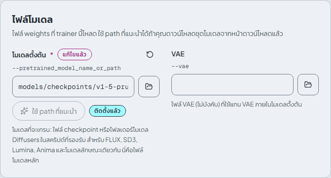

ค่าเริ่มต้นใช้เริ่มต้นได้เลย: network rank 16, learning rate 1e-4, 10 epoch, AdamW8bit ในส่วน **หน่วยความจำและความเร็ว** ให้ตั้ง **Mixed precision** เป็น `bf16` ถ้าใช้ GPU รุ่น RTX 30xx ขึ้นไป ดูทุกส่วนได้ที่[การเทรน](training.md)

## 5. เพิ่มเข้าคิว

รายการ **ความพร้อม** ทางขวาบอกว่ายังขาดอะไร เมื่อขึ้นว่า **พร้อมเพิ่มเข้าคิวแล้ว** ให้กด **เพิ่มเข้าคิว** ส่วน **ตัวอย่างคำสั่ง** แสดงคำสั่งจริงที่จะรัน

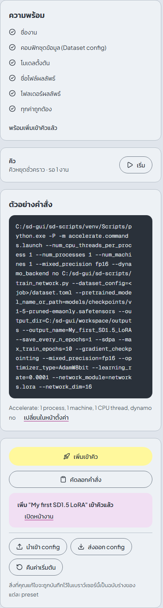

คิวเริ่มต้นใน**สถานะหยุดชั่วคราว** จึงยังไม่มีอะไรรัน

## 6. เริ่มงาน

เปิดหน้า **งาน** แล้วกด **เริ่ม** จะรันเพียงหนึ่งงาน และคิวจะหยุดชั่วคราวอีกครั้งเมื่อจบ คุณจึงควบคุมได้เสมอ เลือกงานของคุณในรายการเพื่อติดตาม

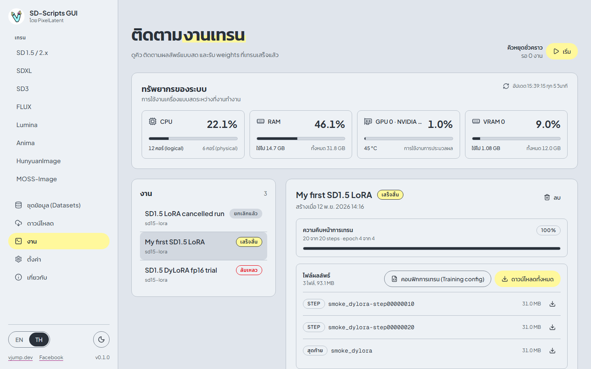

**Log การเทรน** แสดงผลลัพธ์ของ sd-scripts แบบสด ส่วนความคืบหน้าแสดง step และ epoch

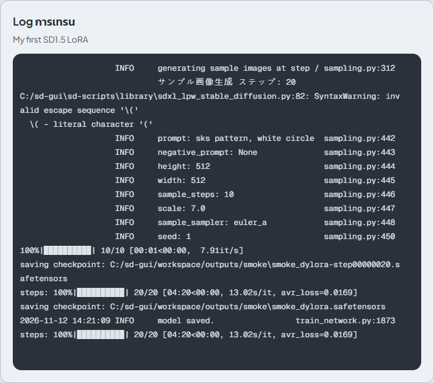

กด **ยกเลิก** เพื่อหยุดงาน process tree ของการเทรนทั้งหมดจะถูกปิด ดู[งาน](jobs.md)

## 7. รับผลลัพธ์

เมื่องาน**เสร็จสิ้น** การ์ด **ไฟล์ผลลัพธ์** จะแสดงรายการไฟล์: **สุดท้าย** คือ LoRA ที่เทรนเสร็จ ส่วนไฟล์ **epoch** และ **step** คือ checkpoint ที่บันทึกไว้ระหว่างทาง กดไอคอนดาวน์โหลดของไฟล์ หรือ **ดาวน์โหลดทั้งหมด** เพื่อรับเป็น zip

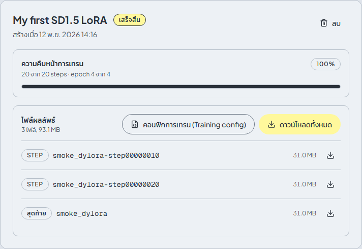

ไฟล์อยู่ใน `workspace/outputs/` ด้วย คัดลอกไฟล์ `.safetensors` ไปไว้ในโฟลเดอร์ LoRA ของโปรแกรมที่คุณใช้สร้างภาพ

ถ้างานล้มเหลว ท้ายของ log จะบอกสาเหตุ ดู[แก้ปัญหา](troubleshooting.md)
