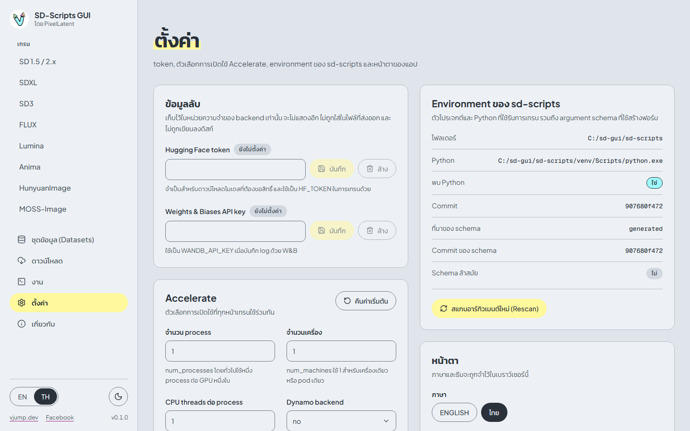
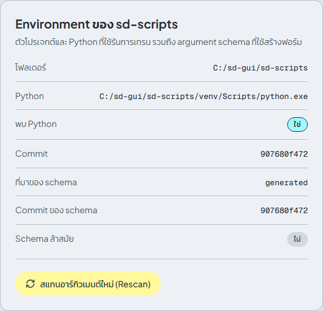

# ตั้งค่า

[English](../en/settings.md) | [ภาษาไทย](settings.md)

## ข้อมูลลับ

| ช่อง | ใช้ทำอะไร |
|---|---|
| **Hugging Face token** | ดาวน์โหลด[โมเดลที่ต้องขอสิทธิ์](downloads.md#โมเดลที่ต้องขอสิทธิ์) และถูกส่งให้การเทรนทุกรอบเป็น `HF_TOKEN` |
| **Weights & Biases API key** | ส่งให้การเทรนเป็น `WANDB_API_KEY` สำหรับรอบที่บันทึก log ด้วย W&B (ตั้ง **เครื่องมือบันทึก log** ในฟอร์มเทรน) |

พิมพ์ค่าแล้วกด **บันทึก** ป้ายจะแสดง **ตั้งค่าแล้ว** หรือ **ยังไม่ตั้งค่า** ค่าที่บันทึกแล้วจะไม่แสดงอีก: กล่องจะว่างและมีข้อความ **มีค่าอยู่แล้ว พิมพ์เพื่อแทนที่** กด **ล้าง** เพื่อลบค่า

ข้อมูลลับเก็บ**ในหน่วยความจำของแอปเท่านั้น** ไม่เคยถูกเขียนลงดิสก์ ไม่ถูกใส่ใน config ที่ส่งออก ไม่แสดงใน API และถูกตัดออกจาก log และข้อความ error ข้อแลกเปลี่ยนคือแอปจะลืมค่าเมื่อหยุดทำงาน บน Windows ให้กรอกใหม่ทุกครั้งที่เปิดแอป ใน Docker image ให้ตั้งตัวแปร `HF_TOKEN` และ `WANDB_API_KEY` เพื่อให้โหลดทุกครั้งที่เริ่ม (ดู[Cloud](cloud-runpod-vast.md))

## Accelerate

ตัวเลือกการเปิดใช้ `accelerate` ใช้ร่วมกันทุกหน้าเทรน ค่าเริ่มต้นเหมาะกับ GPU ใบเดียวและแทบไม่ต้องเปลี่ยน

| ตัวเลือก | Flag | ค่าเริ่มต้น |
|---|---|---|
| **จำนวน process** | `--num_processes` | 1 (โดยทั่วไปหนึ่งต่อ GPU หนึ่งใบ) |
| **จำนวนเครื่อง** | `--num_machines` | 1 |
| **CPU threads ต่อ process** | `--num_cpu_threads_per_process` | 1 |
| **Dynamo backend** | `--dynamo_backend` | `no`: ปิด `torch.compile` ปลอดภัยที่สุด ตัวเลือกอื่น: `eager`, `aot_eager`, `inductor` |

การเปลี่ยนแปลงถูกบันทึกอัตโนมัติในเบราว์เซอร์นี้ ตัวเลขที่ไม่ถูกต้องจะถูกเน้นสี และจะใช้ 1 แทนเมื่อเพิ่มงาน **คืนค่าเริ่มต้น** รีเซ็ตทั้งสี่ช่อง ค่าปัจจุบันแสดงใต้ **ตัวอย่างคำสั่ง** ของแต่ละหน้าเทรน

## Environment ของ sd-scripts

| แถว | ความหมาย |
|---|---|
| **โฟลเดอร์** | ตัว checkout ของ sd-scripts ที่ใช้รันการเทรน |
| **Python** | Python ของ virtual environment ของมัน |
| **พบ Python** | **ใช่** เมื่อมี Python นั้นอยู่ ถ้าเป็น **ไม่** หน้าเทรนจะแสดงแถบ **ยังไม่ได้ติดตั้ง sd-scripts** ให้รัน `install.bat` หรือใช้ Docker image |
| **Commit** | git commit ของ checkout |
| **ที่มาของ schema** | `generated` (สร้างจาก checkout ของคุณ) หรือ `bundled` (มาพร้อมแอป) |
| **Commit ของ schema** | commit ของ sd-scripts ที่ใช้สร้างฟอร์ม argument |
| **Schema ล้าสมัย** | **ใช่** เมื่อ commit ของ schema ต่างจาก commit ของ checkout |

ฟอร์มในหน้าเทรนสร้างจาก **argument schema** คือรายการ argument ทุกตัวของสคริปต์ sd-scripts ทุกตัว เมื่ออัปเดต sd-scripts (เช่น `UPDATE=1 install.bat`) argument อาจเปลี่ยน แอปจะแสดงแถบในหน้าอื่นว่า *argument schema ถูกสร้างจาก sd-scripts คนละ commit กับที่ติดตั้งอยู่ ให้สแกนใหม่เพื่อให้ฟอร์มตรงกัน* กด **เปิดหน้าตั้งค่าเพื่อสแกนใหม่** หรือกด **สแกนอาร์กิวเมนต์ใหม่ (Rescan)** ที่นี่ แอปจะอ่าน argument จาก sd-scripts ที่ติดตั้งอยู่เป็นงานเบื้องหลัง (**กำลังสแกนใหม่...**) และฟอร์มจะอัปเดตเมื่อเสร็จ ระหว่างนั้นจะใช้ schema ที่มาพร้อมแอป ถ้า rescan ล้มเหลว จะแสดงข้อผิดพลาดใต้ปุ่ม

## หน้าตา

**ภาษา** (English หรือ ไทย) และ **ธีม** (**ตามระบบ**, **สว่าง**, **มืด**) ทั้งสองถูกจำไว้ในเบราว์เซอร์นี้ ตัวสลับสองตัวเดียวกันอยู่ที่ท้าย sidebar

## Workspace และการเข้าถึง

**โฟลเดอร์ workspace** แสดงที่เก็บโมเดล dataset ผลลัพธ์ และ log การเขียนไฟล์ทั้งหมดอยู่ภายในนี้ **การป้องกันด้วยรหัสผ่าน** แสดง **เปิด** หรือ **ปิด** ใน Docker image จะ**เปิด**ไว้ตั้งแต่ต้น ด้วยรหัสผ่านที่สร้างให้หรือที่คุณตั้งเอง (ดู[Cloud](cloud-runpod-vast.md#รหัสผ่าน)) เมื่อปิดอยู่ ใครที่เข้าถึง address นี้ได้ก็ใช้แอปได้ ให้ตั้ง `SD_SCRIPTS_GUI_PASSWORD` บนเซิร์ฟเวอร์เพื่อบังคับใช้รหัสผ่าน แอปเดสก์ท็อปรับการเชื่อมต่อจากเครื่องนี้เท่านั้น

## โมเดลความปลอดภัย

- **การล็อกอินเข้าแอปเท่ากับควบคุมเครื่องได้เต็มที่** เหมือน Jupyter: สั่งรันคำสั่งเทรน และอ่านและเขียนไฟล์ใน workspace ได้ จึงควรปกป้อง address และรหัสผ่านให้ดี
- **ไฟล์โมเดลอาจมีโค้ดซ่อนอยู่** โหลดโมเดลจากแหล่งที่คุณไว้ใจเท่านั้น
- **path ที่เขียนไฟล์ถูกจำกัดอยู่ใน workspace** โฟลเดอร์ผลลัพธ์ log และ cache ชี้ออกนอก workspace ไม่ได้ และชี้เข้าโฟลเดอร์ข้อมูลของแอปเองก็ไม่ได้ ข้อนี้กันความผิดพลาด ไม่ใช่ sandbox
- **นำเข้าเฉพาะ training config ที่ไว้ใจได้** เช่น `resume_from_huggingface` จะดาวน์โหลดและโหลด training state
- **request ข้ามเว็บไซต์ไปยัง API ถูกบล็อก** หน้าเว็บที่เปิดไว้ในแท็บอื่นจึงสั่งแอปไม่ได้
- ข้อมูลลับอยู่ในหน่วยความจำเท่านั้น (ดู[ข้อมูลลับ](#ข้อมูลลับ)) บน address แบบ `http://` ธรรมดา Basic authentication ส่งรหัสผ่านเป็นข้อความธรรมดา ควรใช้ HTTPS
