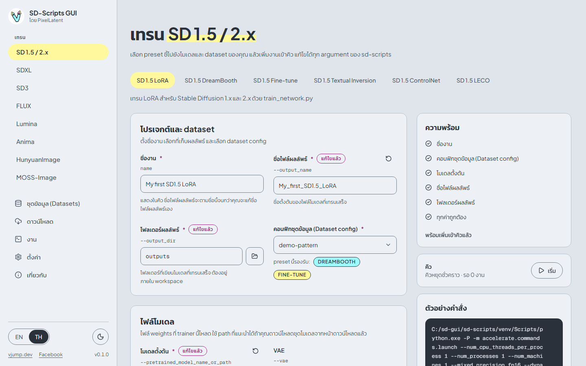
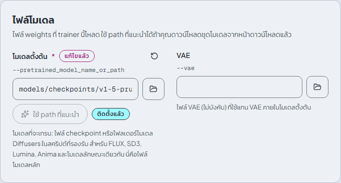
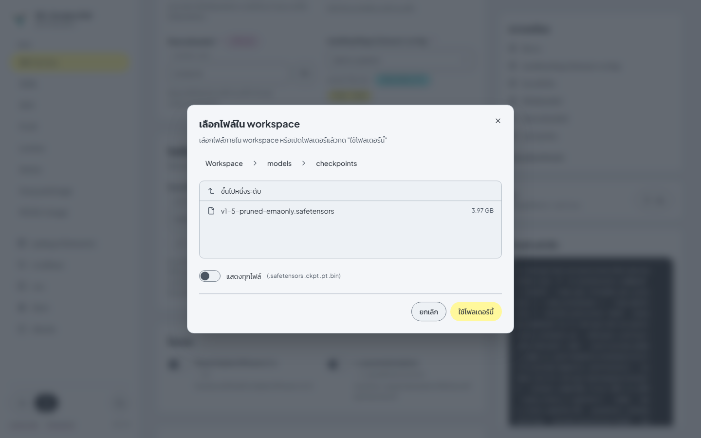
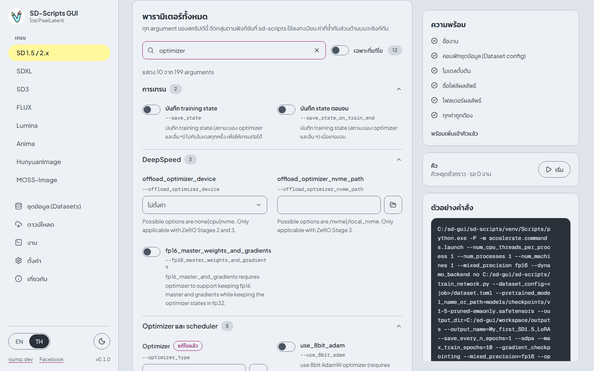
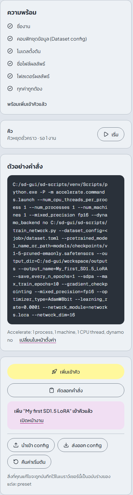

# การเทรน

[English](../en/training.md) | [ภาษาไทย](training.md)

แต่ละตระกูลโมเดลมีหน้าของตัวเองใต้หัวข้อ **เทรน** ใน sidebar หน้าหนึ่งมีแท็บของ **preset** หลายอัน preset คือจุดเริ่มต้นที่คัดมาแล้วสำหรับสคริปต์ sd-scripts หนึ่งตัว: รู้ว่าสคริปต์ต้องใช้ไฟล์โมเดลอะไร มีค่าเริ่มต้นที่เหมาะสม และรู้ว่ารับ dataset ชนิดไหนได้ ทุก argument ของสคริปต์ยังแก้ไขได้ทั้งหมด



## Preset ของแต่ละตระกูล

8 ตระกูล 25 preset "ไฟล์โมเดลที่จำเป็น" คือช่องใน **ไฟล์โมเดล** ที่ต้องกรอกก่อนจึงจะเพิ่มงานได้

| ตระกูล | Preset | สคริปต์ | ชนิด dataset | ไฟล์โมเดลที่จำเป็น |
|---|---|---|---|---|
| SD 1.5 / 2.x | SD 1.5 LoRA | `train_network.py` | DreamBooth, Fine-tune | โมเดลตั้งต้น |
| SD 1.5 / 2.x | SD 1.5 DreamBooth | `train_db.py` | DreamBooth | โมเดลตั้งต้น |
| SD 1.5 / 2.x | SD 1.5 Fine-tune | `fine_tune.py` | Fine-tune | โมเดลตั้งต้น |
| SD 1.5 / 2.x | SD 1.5 Textual Inversion | `train_textual_inversion.py` | DreamBooth, Fine-tune | โมเดลตั้งต้น |
| SD 1.5 / 2.x | SD 1.5 ControlNet | `train_control_net.py` | ControlNet | โมเดลตั้งต้น |
| SD 1.5 / 2.x | SD 1.5 LECO | `train_leco.py` | ไม่ใช้ dataset (ใช้ prompt อย่างเดียว) | โมเดลตั้งต้น |
| SDXL | SDXL LoRA | `sdxl_train_network.py` | DreamBooth, Fine-tune | โมเดลตั้งต้น |
| SDXL | SDXL Fine-tune | `sdxl_train.py` | DreamBooth, Fine-tune | โมเดลตั้งต้น |
| SDXL | SDXL Textual Inversion | `sdxl_train_textual_inversion.py` | DreamBooth, Fine-tune | โมเดลตั้งต้น |
| SDXL | SDXL ControlNet | `sdxl_train_control_net.py` | ControlNet | โมเดลตั้งต้น |
| SDXL | SDXL ControlNet-LLLite | `sdxl_train_control_net_lllite.py` | ControlNet | โมเดลตั้งต้น |
| SDXL | SDXL LECO | `sdxl_train_leco.py` | ไม่ใช้ dataset (ใช้ prompt อย่างเดียว) | โมเดลตั้งต้น |
| SD3 | SD3 LoRA | `sd3_train_network.py` | DreamBooth, Fine-tune | โมเดลตั้งต้น |
| SD3 | SD3 Fine-tune | `sd3_train.py` | DreamBooth, Fine-tune | โมเดลตั้งต้น |
| FLUX | FLUX.1 LoRA | `flux_train_network.py` | DreamBooth, Fine-tune | โมเดลตั้งต้น, Text encoder CLIP-L, Text encoder T5-XXL, Autoencoder (AE) |
| FLUX | Chroma LoRA | `flux_train_network.py` | DreamBooth, Fine-tune | โมเดลตั้งต้น, Text encoder T5-XXL, Autoencoder (AE) |
| FLUX | FLUX.1 Fine-tune | `flux_train.py` | DreamBooth, Fine-tune | โมเดลตั้งต้น, Text encoder CLIP-L, Text encoder T5-XXL, Autoencoder (AE) |
| FLUX | FLUX.1 ControlNet | `flux_train_control_net.py` | ControlNet | โมเดลตั้งต้น, Text encoder CLIP-L, Text encoder T5-XXL, Autoencoder (AE) |
| Lumina | Lumina LoRA | `lumina_train_network.py` | DreamBooth, Fine-tune | โมเดลตั้งต้น, Text encoder Gemma 2, Autoencoder (AE) |
| Lumina | Lumina Fine-tune | `lumina_train.py` | DreamBooth, Fine-tune | โมเดลตั้งต้น, Text encoder Gemma 2, Autoencoder (AE) |
| Anima | Anima LoRA | `anima_train_network.py` | DreamBooth, Fine-tune | โมเดลตั้งต้น, Text encoder Qwen3, VAE |
| Anima | Anima Fine-tune | `anima_train.py` | DreamBooth, Fine-tune | โมเดลตั้งต้น, Text encoder Qwen3, VAE |
| Anima | Anima ControlNet-LLLite | `anima_train_control_net_lllite.py` | ControlNet | โมเดลตั้งต้น, Text encoder Qwen3, VAE |
| HunyuanImage | HunyuanImage LoRA | `hunyuan_image_train_network.py` | DreamBooth, Fine-tune | โมเดลตั้งต้น, Text encoder, Text encoder byT5, VAE |
| MOSS-Image | MOSS-Image LoRA | `moss_image_train_network.py` | DreamBooth, Fine-tune | โมเดลตั้งต้น, Text encoder, VAE |

preset แบบ LoRA ให้เลือก **Network module** ได้

| ตระกูล | Network module |
|---|---|
| SD 1.5 / 2.x | `networks.lora`, `networks.dylora`, `networks.lora_fa`, `networks.oft_v2`, `networks.boft` |
| SDXL | รายการของ SD 1.5 บวก `networks.loha`, `networks.lokr` |
| SD3 | `networks.lora_sd3` |
| FLUX (FLUX.1 และ Chroma) | `networks.lora_flux`, `networks.oft_flux` |
| Lumina | `networks.lora_lumina` |
| Anima | `networks.lora_anima`, `networks.loha`, `networks.lokr` |
| HunyuanImage | `networks.lora_hunyuan_image` |
| MOSS-Image | `networks.lora_generic`, `networks.loha`, `networks.lokr` |
| LECO (SD 1.5, SDXL) | `networks.lora` |

## องค์ประกอบของหน้า

| ส่วน | หน้าที่ |
|---|---|
| **โปรเจกต์และ dataset** | **ชื่องาน** (แสดงในคิว **ชื่อไฟล์ผลลัพธ์** จะตามชื่อนี้จนกว่าคุณจะแก้เอง), **โฟลเดอร์ผลลัพธ์** (ต้องอยู่ใน workspace), **คอนฟิกชุดข้อมูล (Dataset config)** |
| **ไฟล์โมเดล** | ไฟล์ weights ที่ trainer โหลด พร้อมปุ่ม **ใช้ path ที่แนะนำ** และปุ่ม **เลือกไฟล์** |
| ส่วนหลัก (essentials) | ค่าที่ใช้บ่อยจัดเป็นกลุ่ม: **โมเดล**, **Network**, **สูตรการเทรน**, **หน่วยความจำและความเร็ว**, **การบันทึก**, **ภาพตัวอย่าง**, **การบันทึก log** บาง preset มีกลุ่ม **Textual Inversion**, **ControlNet** หรือ **LECO** เพิ่ม |
| **พารามิเตอร์ทั้งหมด** | ทุก argument ของสคริปต์ |
| คอลัมน์ขวา | **ความพร้อม**, **คิว**, **ตัวอย่างคำสั่ง**, **เพิ่มเข้าคิว** และเครื่องมือจัดการ config |

### โปรเจกต์และ dataset

เลือก **คอนฟิกชุดข้อมูล (Dataset config)** ที่สร้างไว้ในหน้า [ชุดข้อมูล (Datasets)](datasets.md) จะแสดงเฉพาะ config ที่ชนิด subset ตรงกับที่ preset ยอมรับ และช่องนี้บอกว่าชนิดที่รับคืออะไร preset แบบ LECO ไม่มีช่อง dataset เพราะเทรนจาก prompt อย่างเดียว

### ไฟล์โมเดล



ช่องไฟล์แต่ละช่องมีกล่องข้อความและปุ่ม **เลือกไฟล์** ปุ่ม **ใช้ path ที่แนะนำ** จะกรอก path ที่ตรงกับชุดโมเดลในหน้า[ดาวน์โหลด](downloads.md) ป้ายข้าง ๆ บอกว่า **ติดตั้งแล้ว** หรือ **ไม่ครบ (N จาก M ไฟล์)** พร้อมลิงก์ **ดาวน์โหลด <ชื่อชุดโมเดล>**

ปุ่ม **เลือกไฟล์** เปิดหน้าต่าง **เลือกไฟล์ใน workspace** (โหมดเบราว์เซอร์) ซึ่งแสดงเฉพาะไฟล์ใน workspace และกรองตามนามสกุล **แสดงทุกไฟล์** ใช้ปิดตัวกรอง ส่วนแอปเดสก์ท็อปจะเปิดหน้าต่างเลือกไฟล์ปกติของ Windows แทน จึงเลือกไฟล์จากที่ไหนในดิสก์ก็ได้



path เป็นแบบสัมพัทธ์กับ workspace (`models/checkpoints/v1-5-pruned-emaonly.safetensors`) หรือแบบเต็มก็ได้ แต่ **โฟลเดอร์ผลลัพธ์** ต้องอยู่ใน workspace เท่านั้น สำหรับ MOSS-Image path ที่แนะนำจะชี้ไปที่ shard แรกของแต่ละโมเดลที่แบ่งเป็นหลายไฟล์

### ส่วนหลัก (essentials)

ส่วนหลักรวมค่าที่แต่ละรอบเทรนมักปรับ เป็นช่องเดียวกับใน **พารามิเตอร์ทั้งหมด** แก้ที่หนึ่งก็เปลี่ยนอีกที่ด้วย

| กลุ่ม | ตัวอย่าง |
|---|---|
| **Network** | **Network module**, **Network rank (dim)**, **Network alpha**, **Network arguments** |
| **สูตรการเทรน** | **Max train epochs**, **Learning rate**, **Optimizer**, **LR scheduler**, **Seed** และค่าเฉพาะโมเดล เช่น **Timestep sampling** ของ FLUX |
| **หน่วยความจำและความเร็ว** | **Mixed precision**, **Gradient checkpointing**, **โมเดลตั้งต้นแบบ FP8**, **Blocks to swap**, **Cache latents**, **Cache text encoder outputs** |
| **การบันทึก** | **ฟอร์แมตไฟล์ที่บันทึก**, **บันทึกทุก N epochs**, **บันทึกทุก N steps**, **เก็บ N epochs ล่าสุด** |
| **ภาพตัวอย่าง** | ช่วงการสร้างภาพตัวอย่างและ sampler รวมถึงกล่อง **Prompt สำหรับภาพตัวอย่าง** |

### พารามิเตอร์ทั้งหมด



ทุก argument ของสคริปต์ จัดกลุ่มตามฟังก์ชันที่ sd-scripts ใช้ลงทะเบียน (**การเทรน**, **Optimizer และ scheduler**, **ชุดข้อมูล (Dataset)**, ...)

- **ค้นหา** ตรงกับชื่อ flag ป้ายชื่อ และคำอธิบาย ขณะค้นหา กลุ่มที่มีผลลัพธ์ตรงกันจะเปิดเองทั้งหมด
- **เฉพาะที่แก้ไข** แสดงเฉพาะ argument ที่ต่างจากค่าเริ่มต้นของ sd-scripts ตัวเลขข้าง ๆ คือจำนวนที่แก้ไข
- ป้าย **แก้ไขแล้ว** ติดที่ช่องที่ต่างจากค่าเริ่มต้นของ sd-scripts
- ปุ่มลูกศรวนกลับ **รีเซ็ตเป็นค่าเริ่มต้น** จะคืนช่องกลับเป็นค่าของ preset

argument ที่ยังไม่มีป้ายชื่อที่คัดไว้ จะแสดงชื่อดิบและคำอธิบายที่ sd-scripts ให้มา

### รายการแบบ key=value (`network_args` และอื่น ๆ)

**Network arguments**, **Optimizer arguments** และ **Scheduler arguments** แก้ไขเป็นแถวของ `คีย์` กับ `ค่า` เพิ่มด้วย **เพิ่มแถว** ตัวอย่าง: `train_blocks=single` (network), `weight_decay=0.01` (optimizer), `T_max=100` (scheduler)

สำหรับ module `lora_flux`, `lora_sd3`, `lora_lumina` และ `lora_hunyuan_image` ค่า boolean ต้องเขียนเป็น `True` หรือ `False` โดยขึ้นต้นด้วยตัวพิมพ์ใหญ่ เช่น `train_t5xxl=True` module เหล่านี้ไม่เข้าใจ `true` ตัวพิมพ์เล็ก หน้าจอจะเน้นคำแนะนำนี้เมื่อเลือกหนึ่งใน module เหล่านั้น

รายการใด ๆ ขึ้นต้นด้วย `-` ไม่ได้ เพื่อกันไม่ให้แอบใส่ flag เข้ามาทางรายการ

### Prompt สำหรับภาพตัวอย่าง

พิมพ์ prompt ในกล่อง **Prompt สำหรับภาพตัวอย่าง** ของกลุ่ม **ภาพตัวอย่าง** หนึ่งบรรทัดต่อหนึ่ง prompt และใส่ flag ต่อท้ายได้

| Flag | ความหมาย |
|---|---|
| `--n` | negative prompt |
| `--w` | ความกว้าง |
| `--h` | ความสูง |
| `--d` | seed |
| `--s` | จำนวน steps |
| `--l` | ค่า CFG scale |

```
a photo of sks cat --n low quality --w 1024 --h 1024 --d 42 --s 28 --l 7.5
```

ข้อความนี้ถูกบันทึกไปกับงานและส่งให้สคริปต์เป็นไฟล์ จะสร้างภาพก็ต่อเมื่อตั้ง **สร้างภาพตัวอย่างทุก N epochs** หรือ **สร้างภาพตัวอย่างทุก N steps** (หรือ **สร้างภาพตัวอย่างก่อนเทรน**) ภาพจะถูกเขียนลงโฟลเดอร์ `sample` ข้างไฟล์ผลลัพธ์

## ตัวอย่างคำสั่งและความพร้อม



- **ความพร้อม** แสดงสิ่งที่ยังขาด: ชื่องาน, dataset, ไฟล์โมเดลที่จำเป็น และค่าที่ไม่ถูกต้อง ปุ่ม **เพิ่มเข้าคิว** จะกดได้เมื่อทุกข้อถูกติ๊กครบ
- **ตัวอย่างคำสั่ง** แสดงคำสั่งจริงที่ backend จะรัน สร้างจากค่าของคุณ อัปเดตตามที่พิมพ์ และรายงานปัญหาที่พบใต้หัวข้อ **ปัญหาที่ backend ตรวจพบ** ปุ่ม **คัดลอกคำสั่ง** ใช้คัดลอก คำสั่งนี้เป็นรายการ argument ธรรมดาและรันโดยไม่ผ่าน shell
- บรรทัดใต้ตัวอย่างแสดงตัวเลือก Accelerate ซึ่งใช้ร่วมกันทุกหน้า แก้ได้ที่หน้า[ตั้งค่า](settings.md)
- **เพิ่มเข้าคิว** สร้างงาน ดู[งาน](jobs.md)

### ส่งออกและนำเข้า config

**ส่งออก config** บันทึกฟอร์มเป็นไฟล์ JSON (`<preset>-training-config.json`) **นำเข้า config** โหลดไฟล์แบบนั้น สลับไปที่ preset ของไฟล์ แล้วกรอกฟอร์มให้ ปุ่มดาวน์โหลด **คอนฟิกการเทรน (Training config)** ของงานในหน้างานใช้รูปแบบเดียวกัน ไฟล์ไม่มีข้อมูลลับเลย **คืนค่าเริ่มต้น** ตั้งทุกค่ากลับเป็นค่าเริ่มต้นของ preset แต่เก็บชื่องานและ dataset ที่เลือกไว้

สิ่งที่คุณแก้ไขจะถูกบันทึกในเบราว์เซอร์เป็นฉบับร่างของแต่ละ preset สลับแท็บหรือโหลดหน้าใหม่ก็ไม่หาย

## เคล็ดลับประหยัดหน่วยความจำ

ถ้าเทรนแล้ว VRAM ไม่พอ ลองตามลำดับนี้ ส่วนใหญ่อยู่ในกลุ่ม **หน่วยความจำและความเร็ว**

| ตัวเลือก | ผลลัพธ์ |
|---|---|
| **Gradient checkpointing** | คำนวณ activation ใหม่เพื่อประหยัด VRAM แลกกับความเร็วที่ลดลงเล็กน้อย เปิดไว้แล้วในเกือบทุก preset |
| **Cache latents** | encode ภาพครั้งเดียวแล้วเก็บผลไว้ ต้องปิด image augmentation ใช้ **Cache latents ลงดิสก์** ได้ด้วย |
| **Cache text encoder outputs** | ปลด text encoder ออกจาก GPU ใช้ร่วมกับการสลับหรือสุ่มทิ้ง caption ไม่ได้ |
| **โมเดลตั้งต้นแบบ FP8** (`fp8_base`) | เก็บโมเดลตั้งต้นเป็น fp8 บางโมเดลไม่รองรับ |
| **Blocks to swap** (`blocks_to_swap`) | ย้าย transformer block ตามจำนวนที่ระบุไปไว้ที่ CPU ประหยัด VRAM ได้มากใน FLUX, SD3 และโมเดลลักษณะเดียวกัน แลกกับความเร็วและ RAM ของเครื่อง |
| **Network rank (dim)** | rank เล็กลง LoRA ก็เล็กลงและใช้หน่วยความจำน้อยลง |
| **Batch size** (ใน dataset config) | เริ่มที่ 1 ก่อน |
| **Mixed precision** | ใช้ `bf16` บน RTX 30xx ขึ้นไป `fp16` อาจล้มเหลวกับบาง network module ดู[แก้ปัญหา](troubleshooting.md#attempting-to-unscale-fp16-gradients) |

preset ตั้งค่าหน่วยความจำที่เหมาะสมไว้ให้แล้วสำหรับ FLUX, SD3, HunyuanImage และโมเดลอื่น ๆ (เช่น **Blocks to swap**) ให้เริ่มจาก preset แล้วเปลี่ยนทีละอย่าง
