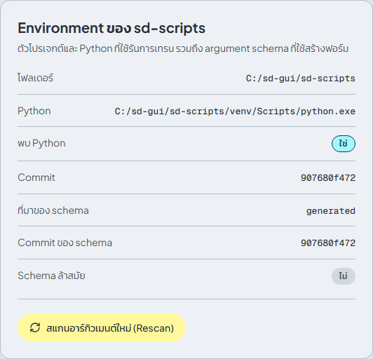

# แก้ปัญหา

[English](../en/troubleshooting.md) | [ภาษาไทย](troubleshooting.md)

## งานล้มเหลว ดูสาเหตุได้ที่ไหน

เปิด **งาน** เลือกงานที่ล้มเหลว แล้วอ่านท้ายของ **Log การเทรน** บรรทัดสุดท้ายคือข้อผิดพลาดของ Python บรรทัดเดียวกันนี้ถูกเก็บเป็นข้อความ error ของงานด้วย เมื่อแก้สาเหตุแล้วกด **ลองอีกครั้ง** เพื่อรันใหม่ด้วยค่าเดิม

## กดเพิ่มเข้าคิวแล้วไม่มีอะไรเกิดขึ้น

คิวเริ่มต้นใน**สถานะหยุดชั่วคราว** เปิด **งาน** แล้วกด **เริ่ม** เริ่มแต่ละครั้งจะรันเพียงหนึ่งงาน ดู[งาน](jobs.md#คิว)

## แถบ "ยังไม่ได้ติดตั้ง sd-scripts"



ไม่พบ Python environment ของ sd-scripts จึงเริ่มเทรนไม่ได้ บน Windows ให้รัน `install.bat` แล้วโหลดหน้าใหม่ ใน Docker image ไม่ควรเกิดเรื่องนี้ ให้ดู log ของ container หน้า **ตั้งค่า > Environment ของ sd-scripts** แสดงโฟลเดอร์และ Python ที่แอปมองหา และ **พบ Python: ไม่** ยืนยันว่าเป็นปัญหานี้ ถ้าย้ายโฟลเดอร์ที่ติดตั้ง ให้รัน `install.bat` อีกครั้งจากที่ใหม่

## argument schema ล้าสมัย

แถบแจ้งว่า *argument schema ถูกสร้างจาก sd-scripts คนละ commit กับที่ติดตั้งอยู่ ให้สแกนใหม่เพื่อให้ฟอร์มตรงกัน* เกิดขึ้นหลังจากอัปเดต sd-scripts ให้เปิดหน้า **ตั้งค่า** แล้วกด **สแกนอาร์กิวเมนต์ใหม่ (Rescan)** ใช้เวลาไม่นาน จากนั้นฟอร์มจะตรงกับเวอร์ชันที่ติดตั้ง ดู[ตั้งค่า](settings.md#environment-ของ-sd-scripts)

## CUDA ใช้ไม่ได้ หรือ torch เป็นแบบ CPU

`install.bat` จะหยุดพร้อมข้อความ *the installed torch is not a CUDA build* เมื่อมีแพ็กเกจอื่นมาแทนที่ PyTorch แบบ CUDA ด้วยแบบ CPU วิธีแก้

1. อัปเดต driver ของ NVIDIA เป็นเวอร์ชันที่รองรับ CUDA 12.8
2. ลบโฟลเดอร์ `sd-scripts\venv` แล้วรัน `install.bat` อีกครั้ง
3. ตรวจด้วย `sd-scripts\venv\Scripts\python.exe -c "import torch; print(torch.__version__, torch.cuda.is_available())"` ควรได้เวอร์ชันที่มี `+cu128` และ `True`

ถ้า driver เก่าเกินไปสำหรับ CUDA 12.8 ให้ตั้ง `TORCH_INDEX_URL` เป็น index อื่นก่อนรัน `install.bat` (ดู[ติดตั้งบน Windows](install-windows.md)) ถ้าแผง **ทรัพยากรของระบบ** ในหน้า **งาน** ขึ้นว่า **ไม่มีข้อมูล GPU และ VRAM** แสดงว่าแอปมองไม่เห็น GPU ของ NVIDIA เหมือนกัน ให้ตรวจว่า `nvidia-smi` ใช้ได้ใน terminal

## หน่วยความจำไม่พอ (Out of memory)

ท้าย log ขึ้น `CUDA out of memory` (หรือ `OutOfMemoryError`) ลองตามลำดับนี้

1. เปิด **Gradient checkpointing**, **Cache latents** และ **Cache text encoder outputs**
2. ลด **Batch size** ใน dataset config และลด **Resolution (กว้าง × สูง)**
3. ลด **Network rank (dim)**
4. สำหรับ FLUX, SD3 และ HunyuanImage เพิ่ม **Blocks to swap** หรือเปิด **โมเดลตั้งต้นแบบ FP8**
5. ปิดโปรแกรมอื่นที่ใช้ GPU แผง **ทรัพยากรของระบบ** แสดง VRAM ที่ใช้อยู่

ดู[การเทรน: เคล็ดลับประหยัดหน่วยความจำ](training.md#เคล็ดลับประหยัดหน่วยความจำ)

## Attempting to unscale FP16 gradients

ท้าย log ขึ้น `ValueError: Attempting to unscale FP16 gradients` เกิดเมื่อ **Mixed precision** เป็น `fp16` และ network module เก็บน้ำหนักที่เทรนเป็น fp16 (เราพบกับ `networks.dylora`) ให้ตั้ง **Mixed precision** เป็น `bf16` ซึ่งใช้ได้กับ GPU รุ่น RTX 30xx ขึ้นไป แล้วกด **ลองอีกครั้ง** ช่องนี้อยู่ในกลุ่ม **หน่วยความจำและความเร็ว** ถ้า GPU รุ่นเก่าไม่รองรับ bf16 ให้ใช้ network module อื่น (เช่น `networks.lora`) กับ fp16

## Hugging Face แจ้ง 401 หรือ 403

ดาวน์โหลด[โมเดลที่ต้องขอสิทธิ์](downloads.md#โมเดลที่ต้องขอสิทธิ์) (**FLUX.1 [dev]**, **Stable Diffusion 3.5**) ล้มเหลว ต้องทำทั้งสองข้อ

1. ยอมรับ license ของโมเดลที่ huggingface.co ด้วยบัญชีที่เป็นเจ้าของ token
2. ใส่ token สิทธิ์ read ที่ **ตั้งค่า > Hugging Face token** กด **บันทึก** แล้วเริ่มดาวน์โหลดใหม่

token เก็บในหน่วยความจำเท่านั้น จึงต้องกรอกใหม่หลังรีสตาร์ทแอป (หรือใช้ environment variable `HF_TOKEN` บนเซิร์ฟเวอร์)

## Port ถูกใช้อยู่แล้ว

`run-browser.bat` ใช้ port 8000 ถ้าโปรแกรมอื่นใช้อยู่ เซิร์ฟเวอร์จะจบการทำงานพร้อมข้อผิดพลาด ให้เลือก port อื่นก่อน

```bat
set SD_SCRIPTS_GUI_PORT=8100
run-browser.bat
```

เบราว์เซอร์จะเปิดที่ address ใหม่ ส่วนหน้าต่างเดสก์ท็อป (`run.bat`) ใช้ port 17860 และจะเปลี่ยนไปใช้ port ว่างอื่นถ้า port นี้ถูกใช้

## หน้าต่างเดสก์ท็อปไม่เปิด (WebView2)

`run.bat` ต้องใช้ Microsoft WebView2 ซึ่งมีมาให้แล้วใน Windows 11 บน Windows 10 ให้ติดตั้ง [WebView2 Runtime](https://developer.microsoft.com/microsoft-edge/webview2/) หรือใช้ `run-browser.bat` ที่เปิดแอปในเบราว์เซอร์ปกติของคุณ

## Path ยาวบน Windows หรือ path ที่ติดตั้งมีตัวอักษรที่ไม่ใช่ ASCII

แพ็กเกจ Python และ PyTorch มีโครงสร้างโฟลเดอร์ลึก path ที่ติดตั้งยาว หรือมีช่องว่าง ตัวอักษรไทย หรืออักขระที่ไม่ใช่ ASCII อื่น อาจทำให้ `install.bat` หรือการเทรนล้มเหลวด้วยข้อผิดพลาดเกี่ยวกับไฟล์ที่ดูแปลก ให้ติดตั้งใน path สั้น ๆ ที่เป็น ASCII เช่น `C:\sd-gui` ถ้าจำเป็นต้องใช้ path ยาว ให้เปิดใช้ long paths ของ Windows (นโยบาย `LongPathsEnabled`) แล้วรีสตาร์ท

## รันออกมาต่างจากตัวอย่างคำสั่ง (accelerate config)

sd-scripts เริ่มทำงานผ่าน `accelerate` ถ้าเคยรัน `accelerate config` บนเครื่องนี้ ไฟล์ `default_config.yaml` ของมันจะถูกรวมเข้าไป**ทุกครั้ง**ที่เปิดงาน และอาจเปลี่ยนค่าบางอย่าง (mixed precision, จำนวน process, dynamo) ที่ **ตัวอย่างคำสั่ง** ไม่ได้แสดง ถ้ารันแล้วผลต่างจากที่ตั้งไว้ ให้ลบไฟล์นี้แล้วเริ่มงานใหม่

| ที่ไหน | ไฟล์ |
|---|---|
| Windows | `%USERPROFILE%\.cache\huggingface\accelerate\default_config.yaml` |
| Docker image | `/workspace/.cache/huggingface/accelerate/default_config.yaml` |

แอปส่งตัวเลือกของตัวเอง (ดู **Accelerate** ในหน้า[ตั้งค่า](settings.md#accelerate)) ผ่านบรรทัดคำสั่งอยู่แล้ว จึงไม่ต้องพึ่งไฟล์นั้น

## โฟลเดอร์ dataset ที่เป็น link ไม่โผล่ในตัวเลือกโฟลเดอร์

โฟลเดอร์ใต้ `workspace\datasets` ที่เป็น link หรือ junction ซึ่งชี้ออกนอก workspace จะไม่แสดงในแท็บ **โฟลเดอร์ภาพ** และในรายการ **เลือกจากโฟลเดอร์ภาพของคุณ** ให้พิมพ์ path เต็มของโฟลเดอร์ปลายทางลงในช่อง **โฟลเดอร์ภาพ** ของ subset แทน การอ่านภาพจากนอก workspace ทำได้ ที่ถูกจำกัดคือ path ที่เขียนไฟล์เท่านั้น

## ชื่อหรือ path ถูกปฏิเสธ

**ชื่อไฟล์ผลลัพธ์** **คำนำหน้าชื่อ log** และชื่อโฟลเดอร์ภาพถูกนำไปใช้เป็นชื่อไฟล์ จึงต้องใช้ได้บน Windows

- ห้ามมี `< > : " / \ | ? *` หรือ `..`
- ห้ามขึ้นต้นหรือลงท้ายด้วยช่องว่าง และห้ามลงท้ายด้วยจุด
- ห้ามเป็นชื่อที่ Windows สงวนไว้ เช่น `CON`, `NUL`, `COM1`

ชื่อภาษาไทย (และอักขระที่ไม่ใช่ ASCII อื่น) ใช้ได้

argument ที่เขียนไฟล์ต้องชี้ไป**ใน workspace** และต้องไม่ชี้เข้าโฟลเดอร์ข้อมูลของแอปเอง (`backend\data`) ข้อนี้ใช้กับ argument ที่ลงท้ายด้วย `_dir`, `_file` หรือ `_path` เช่น ไฟล์ console log โฟลเดอร์ cache ของ tokenizer และ path สำหรับ DeepSpeed offload ให้ใช้โฟลเดอร์อย่าง `outputs` หรือ `logs`

## ไฟล์อยู่ที่ไหน

| อะไร | Windows | Docker image |
|---|---|---|
| โมเดลที่ดาวน์โหลด | `workspace\models` | `/workspace/models` |
| โฟลเดอร์ภาพ | `workspace\datasets` | `/workspace/datasets` |
| LoRA และ checkpoint ที่เทรนเสร็จ | `workspace\outputs` | `/workspace/outputs` |
| Log (TensorBoard) | `workspace\logs` | `/workspace/logs` |
| ประวัติงาน, dataset config, log ของงาน | `backend\data` | `/workspace/.sd-scripts-gui` |
| sd-scripts และ environment ของมัน | `sd-scripts\`, `sd-scripts\venv` | `/opt/sd-scripts`, `/opt/sd-venv` |
| Environment ของ backend | `backend\.venv` | `/opt/app/backend/.venv` |

ถ้าอยากรีเซ็ตแอปโดยไม่แตะไฟล์ของคุณ ให้ปิดแอปแล้วลบ `backend\data` คุณจะเสียประวัติงานและ dataset config แต่โมเดล ภาพ และผลลัพธ์ยังอยู่

## ยังแก้ไม่ได้?

สอบถามได้ที่[เพจ Facebook](https://www.facebook.com/pixellatent) ส่งอีเมลมาที่ [vjumpkung@gmail.com](mailto:vjumpkung@gmail.com) หรือเปิด [GitHub issue](https://github.com/vjumpkung/vjump-sd-scripts-gui/issues) พร้อมแนบท้ายของ log การเทรน (ข้อมูลลับถูกตัดออกจากมันแล้ว) และเวอร์ชันที่แสดงใน sidebar
